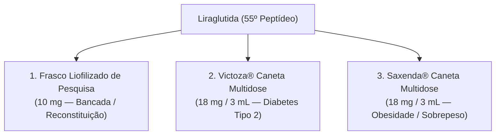

# PeptiPedia — Dossiê Científico e Farmacotécnico: Liraglutida (Etapa P2E)

**Data da Emissão:** 18 de outubro de 2026  
**Composto Cadastrado:** Liraglutida (`liraglutide`) — 55º Composto do Catálogo PeptiPedia  
**Categoria:** Metabolismo & Emagrecimento  
**Status Regulatório:** Aprovado FDA (2010 Victoza / 2014 Saxenda), EMA (2009 / 2015) e Anvisa (2010 / 2016)

---

## 1. Identificação Farmacoquímica e Estrutura Molecular

A liraglutida é um análogo sintético de ação prolongada do peptídeo semelhante ao glucagon 1 humano ($\text{GLP-1}_{(7-37)}$), obtido por engenharia genética recombinante em *Saccharomyces cerevisiae* e subsequente derivatização química sintética.

- **Nome Químico IUPAC / Denominação Comum Internacional:**  
  $\text{Arg}^{34}\text{Lys}^{26}\text{-(}N^{\epsilon}\text{-}(\gamma\text{-L-glutamil(}N^{\alpha}\text{-hexadecanoil)))}\text{-GLP-1}_{(7-37)}$
- **Fórmula Molecular Empírica:** $\text{C}_{172}\text{H}_{265}\text{N}_{43}\text{O}_{51}$
- **Massa Molar / Peso Molecular Teórico:** $3.751,20\text{ Da}$ ($3.751,20\text{ g/mol}$)
- **Código CAS:** `204656-20-2`
- **PubChem CID:** `16134956`
- **DrugBank ID:** `DB06655`
- **Sequência Linear de Aminoácidos:**
  ```text
  H-His-Ala-Glu-Gly-Thr-Phe-Thr-Ser-Asp-Val-Ser-Ser-Tyr-Leu-Glu-Gly-Gln-Ala-Ala-
  Lys(gamma-Glu-palmitoyl)-Glu-Phe-Ile-Ala-Trp-Leu-Val-Arg-Gly-Arg-Gly-OH
  ```
- **Modificações Estruturais Chave:**
  1. **Substituição Pontual $\text{Lys}^{34}\text{Arg}$:** Substituição de lisina por arginina na posição 34 para permitir acilação monosseletiva na lisina residual da posição 26.
  2. **Acilação Graxa $\text{C16}$ com Espaçador $\gamma$-Glutamil:** Acoplamento covalente de uma cadeia graxa de ácido palmítico ($N^{\alpha}\text{-hexadecanoil}$) através de um espaçador glutâmico na posição $\text{Lys}^{26}$. A lipofilicidade agregada promove autooligomerização em heptâmeros reversíveis no tecido subcutâneo e ligação não covalente de alta afinidade (>98%) à albumina sérica humana, retardando o clearance renal e a proteólise por dipeptidil peptidase-4 (DPP-4).

---

## 2. Mecanismo de Ação e Farmacodinâmica

A liraglutida atua como agonista seletivo do receptor transmembrana de GLP-1 ($\text{GLP-1R}$), acoplado à proteína $\text{G}_{\alpha\text{s}}$:
1. **Ativação da Adenilato Ciclase:** Induz rápida elevação de monofosfato cíclico de adenosina ($\text{cAMP}$) intracelular e ativação de proteína quinase A ($\text{PKA}$) e $\text{Epac2}$ nas células beta do pâncreas.
2. **Insulinotropismo Dependente de Glicose:** Promove exocitose de grânulos de insulina estritamente sob concentrações plasmáticas elevadas de glicose, minimizando o risco intrínseco de hipoglicemia em comparação a secretagogos tradicionais (como sulfonilureias).
3. **Supressão do Glucagon Pós-Prandial:** Inibe a secreção desregulada de glucagon pelas células alfa pancreáticas durante as refeições.
4. **Retardo do Esvaziamento Gástrico:** Reduz temporariamente a taxa de trânsito gastrointestinal, achatando os picos glicêmicos pós-prandiais.
5. **Saciedade no Sistema Nervoso Central:** Cruza a barreira hematoencefálica nas regiões fenestradas circunventriculares, ativando diretamente receptores de GLP-1 em neurônios pró-opiomelanocortina ($\text{POMC}$) e transcrito regulado por anfetamina e cocaína ($\text{CART}$) no núcleo arqueado hipotalâmico, enquanto inibe os neurônios orexígenos $\text{NPY/AgRP}$, reduzindo os impulsos de apetite e o consumo calórico diário.

---

## 3. Farmacocinética e Metabolismo Humano

- **Absorção e Biodisponibilidade Subcutânea:** A absorção após injeção subcutânea é gradual, com concentração plasmática máxima ($\text{C}_{\max}$) alcançada entre 8 e 12 horas pós-dose. A biodisponibilidade absoluta é de aproximadamente 55%.
- **Ligação a Proteínas Plasmáticas:** Superior a 98%, mediada primariamente pela interação hidrofóbica da cauda de palmitoil com os bolsões lipídicos da albumina sérica.
- **Meia-Vida Plasmática de Eliminação ($t_{1/2}$):** Aproximadamente 13 horas (faixa de 11 a 15 horas), viabilizando administração diária em injeção única independente do horário das refeições.
- **Biotransformação e Clearance:** Não é metabolizada primariamente por enzimas do complexo citocromo P450 nem eliminada inalterada por via renal. O clearance ocorre via endopeptidases neutras e dipeptidil peptidase-4, seguida de catabolismo lisossomal em aminoácidos e fragmentos peptídicos menores. Apenas traços ínfimos (<6%) de metabólitos inativos são detectados na urina e nas fezes.

---

## 4. Alertas Críticos de Segurança e Advertência em Caixa (Boxed Warning)

> [!WARNING] **ALERTA DE SEGURANÇA MÁXIMA — ADVERTÊNCIA DE ROTULAGEM (BOXED WARNING FDA)**
> A liraglutida causa tumores de células C da tireoide (adenomas e carcinomas medulares) em roedores de forma dose e tempo-dependente em exposições clinicamente relevantes. É desconhecido se a liraglutida causa carcinoma medular de tireoide (MTC) em humanos, pois a densidade de receptores de GLP-1 em células C de primatas e humanos é substancialmente inferior à dos roedores.
>
> **Contraindicações Absolutas:**
> - Pacientes com histórico pessoal ou familiar de Carcinoma Medular de Tireoide (MTC).
> - Pacientes portadores da Síndrome de Neoplasia Endócrina Múltipla tipo 2 (NEM-2).
> - Hipersensibilidade documentada à liraglutida ou a qualquer um dos excipientes comerciais.

### Eventos Adversos Frequentes e Monitoramento
- **Gastrointestinais:** Náuseas (20% a 39%), diarreia (12% a 21%), constipação (19% a 24%), vômitos (11% a 16%) e dispepsia. Os episódios são mais frequentes no início da terapia e atenuam-se com a titulação posológica semanal gradual.
- **Pancreatite Aguda:** Risco incomum, porém grave; descontinuar imediatamente se houver suspeita de dor abdominal persistente irradiada para o dorso.
- **Litíase Biliar e Colecistite:** Aumento da incidência associado à perda rápida de peso corporal.

---

## 5. Implementação no Catálogo: Sistema Multiformulação

Para sanear a confusão metodológica do mercado entre medicamentos industriais prontos e apresentações de pesquisa laboratorial, o dossiê da Liraglutida foi cadastrado na P2E com três formulações expressamente categorizadas:



### Apresentação 1: Frasco Liofilizado de Bancada (`liraglutide-lyophilized-research`)
- **Tipo:** Pó liofilizado estéril para reconstituição (`isReconstitutionVial: true`).
- **Massa Nominal:** `nominalVialMg: 10` (10 mg).
- **Apresentação Primária da Calculadora:** Integrada à calculadora de reconstituição para fins de pesquisa acadêmica.
- **Reconstituição Recomendada:** Diluição com 2,0 mL de Água Bacteriostática a 0,9% (BAC Water) resulta em concentração de $5,0\text{ mg/mL}$ ($5.000\text{ mcg/mL}$).
- **Cálculo U-100:** Cada 0,01 mL (1 UI na seringa U-100) entrega $50\text{ mcg}$. Uma dose laboratorial de $600\text{ mcg}$ requer exatamente $0,12\text{ mL}$ ($12\text{ unidades U-100}$).
- **Armazenamento:** Pó anidro estocado a -20°C; após reconstituição, conservar estritamente a 2°C a 8°C.

### Apresentação 2: Victoza® Caneta Autoinjetora Pronta (`liraglutide-pen-victoza-18mg`)
- **Tipo:** Solução injetável líquida formulada para uso subcutâneo (`isReconstitutionVial: false`).
- **Concentração:** $6,0\text{ mg/mL}$ (Frasco carpule de $3,0\text{ mL}$ contendo $18\text{ mg}$ de liraglutida).
- **Indicação Clínica Registrada:** Tratamento de Diabetes Mellitus tipo 2 em adultos e pediátricos $\ge 10$ anos, e redução de risco de eventos cardiovasculares maiores (MACE).
- **Posologia Padrão de Bula:** Dose inicial de $0,6\text{ mg/dia}$ por 1 semana; escalonamento para $1,2\text{ mg/dia}$; dose máxima de $1,8\text{ mg/dia}$.
- **Calculadora:** Bloqueada para reconstituição na interface por se tratar de dispositivo pronto com dosador mecânico fixo em mg.

### Apresentação 3: Saxenda® Caneta Autoinjetora Pronta (`liraglutide-pen-saxenda-18mg`)
- **Tipo:** Solução injetável líquida formulada para uso subcutâneo (`isReconstitutionVial: false`).
- **Concentração:** $6,0\text{ mg/mL}$ (Frasco carpule de $3,0\text{ mL}$ contendo $18\text{ mg}$ de liraglutida).
- **Indicação Clínica Registrada:** Controle crônico de peso corporal em adultos com IMC $\ge 30\text{ kg/m}^2$ (obesidade) ou $\ge 27\text{ kg/m}^2$ (sobrepeso) com comorbidades associadas.
- **Escalonamento Semanal de Bula:**
  - Semana 1: $0,6\text{ mg/dia}$
  - Semana 2: $1,2\text{ mg/dia}$
  - Semana 3: $1,8\text{ mg/dia}$
  - Semana 4: $2,4\text{ mg/dia}$
  - Semana 5 em diante (Manutenção): $3,0\text{ mg/dia}$
- **Calculadora:** Bloqueada para reconstituição na interface (caneta pronta pré-calibrada).

---

## 6. Conclusão

A integração da Liraglutida na versão P2E estabelece o mais alto padrão de precisão farmacoquímica do PeptiPedia, demonstrando a superioridade do modelo multiformulação para distinguir ferramentas industriais registradas de reagentes de bancada para reconstituição.
