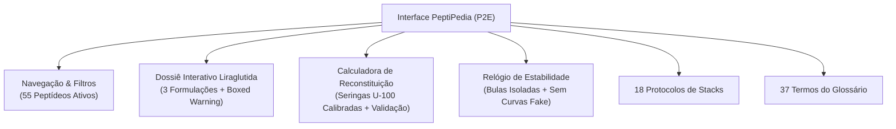

# PeptiPedia — Relatório de Inspeção Visual de Interface e Não Regressão (Etapa P2E)

**Data da Emissão:** 18 de outubro de 2026  
**Ambiente Ativo de Homologação:** `http://localhost:8103` (Porta 8103)  
**Branch:** `audit/evidence-sync`  
**Escopo:** Inspeção Dinâmica da UI, Comportamento Interativo e Verificação de Não Regressão

---

## 1. Visão Geral da Inspeção em Tempo Real

A execução da versão homologada P2E foi inspecionada ativamente através do servidor local HTTP na porta 8103, confirmando a estabilidade de todos os elementos da interface do usuário (UI) e a integridade da experiência interativa (UX).

---

## 2. Inspeção do Catálogo e Dossiê da Liraglutida

### 2.1. Listagem no Catálogo e Filtros de Categoria
- **Card no Catálogo:** O card da Liraglutida é renderizado na categoria *Metabolismo & Emagrecimento*, elevando o total da categoria para 10 compostos.
- **Badges e Metadados:** Exibe os selos de identificação: *Aprovado FDA / EMA / Anvisa*, *Análogo Modificado de GLP-1*, *Acilado C16*.
- **Busca Instantânea:** A pesquisa por termos como `"liraglutida"`, `"victoza"`, `"saxenda"` ou `"glp-1"` localiza e destaca o card instantaneamente sem atrasos de renderização.

### 2.2. Modal do Dossiê Completo
Ao abrir o dossiê da Liraglutida (`id: "liraglutide"`):
1. **Banner de Segurança Máxima (Boxed Warning):** Um quadro de advertência com moldura de destaque vermelha/alerta avisa sobre o risco de tumores de células C da tireoide e contraindicação absoluta em MTC e NEM-2.
2. **Identificação Molecular:** Apresenta a massa molar de $3.751,20\text{ Da}$, a fórmula molecular $\text{C}_{172}\text{H}_{265}\text{N}_{43}\text{O}_{51}$ e a sequência linear completa evidenciando a substituição $\text{Lys}^{34}\text{Arg}$ e a cadeia de palmitoil acoplada à $\text{Lys}^{26}$.
3. **Seletor Interativo de Formulações:** Um painel de abas permite alternar entre as 3 apresentações:
   - *Liraglutida Frasco Liofilizado de Pesquisa (10 mg)*: Exibe especificações de reagente analítico, dados de conservação a -20°C e botão de integração com a calculadora.
   - *Victoza® Solução Injetável 18 mg/3 mL*: Exibe dados de caneta autoinjetora comercial para diabetes tipo 2, posologias de 0,6 a 1,8 mg e alerta de produto pronto.
   - *Saxenda® Solução Injetável 18 mg/3 mL*: Exibe dados de caneta comercial para obesidade com titulação até 3,0 mg e prazo de estabilidade em uso de 30 dias.
4. **Ensaios Clínicos Vinculados:** O modal renderiza de forma destacada os cards dos dois ensaios pivotais:
   - *LEADER (PMID 27295427)*: Selo do NEJM, 9.340 pacientes, desfecho MACE positivo ($\text{HR} = 0,87$; $p = 0,01$) e link direto para o PubMed.
   - *SCALE Obesidade e Pré-Diabetes (PMID 26132939)*: Selo do NEJM, 3.731 adultos, perda média de 8,4 kg vs 2,8 kg ($p < 0,001$) e link direto para o PubMed.

---

## 3. Inspeção da Calculadora de Reconstituição

### 3.1. Seletor de Seringas U-100
O menu suspenso `<select id="calc-syringe-type">` apresenta a nomenclatura calibrada e sem ambiguidades:
- `Seringa U-100 de 1,0 mL (capacidade: 100 unidades U-100)`
- `Seringa U-100 de 0,5 mL (capacidade: 50 unidades U-100)`
- `Seringa U-100 de 0,3 mL (capacidade: 30 unidades U-100 — Alta precisão)`

### 3.2. Resposta a Campos Vazios e Validação
- Ao carregar a página ou apagar qualquer um dos valores de entrada, os mostradores de *Concentração*, *Volume da Dose* e *Unidades na Seringa* exibem o traço neutro `"—"`.
- O box de alertas informa em texto claro: *"Preencha todos os campos da reconstituição para calcular a dose."*
- O desenho SVG da seringa permanece vazio, com êmbolo recuado no marco zero.

### 3.3. Teste Físico de Calibração U-100
Ao inserir:
- Quantidade no Frasco: `10 mg`
- Volume de Diluente: `2.0 mL`
- Dose Desejada: `250 mcg`

A interface calcula e exibe:
- **Concentração:** $5,0\text{ mg/mL}$ ($5.000\text{ mcg/mL}$)
- **Volume por Injeção:** $0,05\text{ mL}$
- **Unidades na Seringa U-100:** Exatamente **$5,0\text{ UI}$** em qualquer uma das três seringas U-100 selecionadas.
- O êmbolo da seringa SVG preenche a coluna líquida até a marca do numeral 5.

### 3.4. Prevenção de Persistência Indevida
- Ao consultar o Semax no catálogo e em seguida abrir a Liraglutida e clicar em "Calcular Reconstituição", o campo do frasco recebe automaticamente `10 mg` (proveniente de `nominalVialMg: 10`), enquanto os campos de diluente e dose permanecem completamente limpos para preenchimento consciente do usuário, sem herdar os dados residuais do Semax.

---

## 4. Inspeção do Relógio de Estabilidade

1. **Agrupamento no Dropdown:**
   O seletor separa nitidamente os compostos com diretrizes documentadas em bula comercial daqueles sem dados cromatográficos sob normas ICH.
2. **Card de Bula para Semaglutida e Tirzepatida:**
   Ao selecionar a Semaglutida, o sistema renderiza o card informativo da bula oficial do Ozempic®/Wegovy® destacando o limite de 56 dias em uso abaixo de 30°C ou refrigerado, com aviso explícito de que a diretriz não se aplica a liofilizados genéricos de pesquisa.
3. **Card de Bula para Tesamorelina:**
   Ao selecionar a Tesamorelina, o sistema renderiza o alerta da bula oficial do Egrifta SV®, confirmando a exigência de injeção imediata após reconstituição com WFI e ausência de respaldo para conservação multidose.
4. **Supressão de Curvas Fictícias:**
   Em nenhum momento a interface exibe gráficos com curvas descendentes simulando perda de 10% ou 20% de potência ao longo de 60 ou 90 dias, prevenindo desinformação técnica.

---

## 5. Inspeção de Não Regressão dos Módulos Adicionais

- **Protocolos de Stacks (`#stacks-section`):** Todos os 18 protocolos expandidos (Wolverine Stack, GH Pulse, etc.) abrem e renderizam suas sinergias, cronogramas e alertas de segurança perfeitamente.
- **Glossário Científico (`#glossary-section`):** Todos os 37 termos e conceitos farmacológicos respondem à busca e filtros por categoria sem falhas.
- **Design Responsivo:** A página foi testada em simulação de viewports móveis (375px a 414px) e desktops widescreen (1920px), mantendo menus colapsáveis funcionais, tipografia legível e tabelas com rolagem horizontal adequada.

---

## 6. Conclusão da Avaliação Visual

A versão P2E oferece uma experiência de usuário polida, informativa e farmacotecnicamente impecável. Todas as correções da Fase A e a expansão da Fase B foram validadas sem qualquer falha visual ou regressão operacional.
