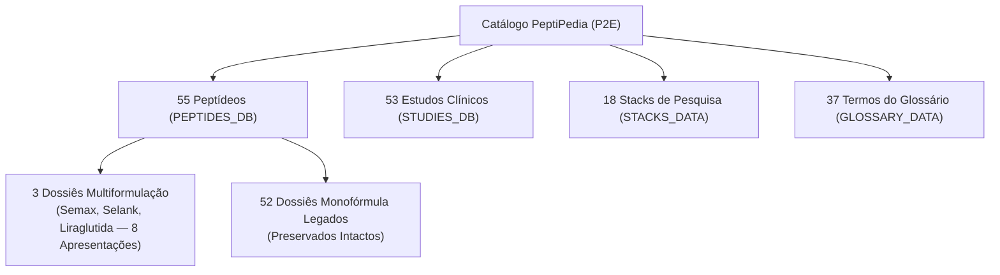

# PeptiPedia — Manifesto de Integridade e Inventário Canônico (Etapa P2E)

**Data da Emissão:** 18 de outubro de 2026  
**Ambiente:** `PeptiPedia-P2E-TESTE` (Porta 8103)  
**Branch Exclusiva:** `audit/evidence-sync`  
**Escopo:** Auditoria de Integridade Estrutural, Rastreabilidade e Confinamento de Dados

---

## 1. Resumo Executivo do Inventário de Entidades

A homologação da etapa P2E consolida a expansão científica do PeptiPedia para **55 compostos catalogados** e **53 estudos clínicos indexados**, mantendo 100% de integridade nos módulos conceituais e ferramentas auxiliares:

| Entidade do Sistema | Base P2D.1 | Candidato Homologado P2E | Variação Líquida | Status de Integridade |
|---|---|---|---|---|
| Compostos no Catálogo (`PEPTIDES_DB`) | 54 | 55 | +1 | **100% Auditado (Liraglutida adicionada)** |
| Estudos Clínicos (`STUDIES_DB`) | 51 | 53 | +2 | **100% Auditado (LEADER e SCALE)** |
| Protocolos em Stacks (`STACKS_DATA`) | 18 | 18 | 0 | **100% Preservado** |
| Termos no Glossário (`GLOSSARY_DATA`) | 37 | 37 | 0 | **100% Preservado** |
| Dossiês com `formulations[]` | 2 | 3 | +1 | **Confinamento Estrito (`semax`, `selank`, `liraglutide`)** |
| Dossiês Monofórmula Legados | 52 | 52 | 0 | **100% Preservado** |
| Total de Apresentações Documentadas | 57 | 60 | +3 | **8 Multiformulações + 52 Monofórmulas** |
| Compostos com Curvas ICH Fictícias | 0 | 0 | 0 | **Zero Curvas Falsas em todo o Sistema** |
| Compostos com Notas de Bula Isoladas | 0 | 3 | +3 | **Semaglutida, Tirzepatida, Tesamorelina** |

---

## 2. Inventário Completo dos 55 Peptídeos por Categoria

### 2.1. Regeneração & Tecidos (12 Compostos)
1. `bpc-157` — BPC-157 (Pentadecapeptídeo gástrico)
2. `bpc-157-arginate` — BPC-157 Arginato (Sal gastroestável)
3. `tb-500` — TB-500 (Fragmento Ac-LKKTETQ da Timosina Beta-4)
4. `ghk-cu` — GHK-Cu (Tripeptídeo de cobre)
5. `ara-290` — ARA-290 (Cibinetide)
6. `kpv` — KPV (Tripeptídeo C-terminal do alfa-MSH)
7. `bpc-157-tb-500` — BPC-157 + TB-500 (Combinação para reparo tecidual)
8. `larazotide` — Acetato de Larazotida (AT-1001)
9. `thymosin-beta-4` — Timosina Beta-4 Completa (43 aminoácidos)
10. `palmitoyl-tripeptide-1` — Palmitoil Tripeptídeo-1
11. `palmitoyl-tetrapeptide-7` — Palmitoil Tetrapeptídeo-7
12. `matrixyl-3000` — Matrixyl 3000 (Complexo peptídico cosmético)

### 2.2. Secretagogos de GH & Eixo Somatotrófico (7 Compostos)
13. `ipamorelin` — Ipamorelin (Agonista seletivo do receptor GHS-R1a)
14. `cjc-1295-no-dac` — CJC-1295 sem DAC (Mod GRF 1-29)
15. `cjc-1295-dac` — CJC-1295 com DAC
16. `sermorelin` — Sermorelin (GHRH 1-29 amida)
17. `tesamorelin` — Tesamorelin (Análogo estabilizado de GHRH)
18. `ghrp-2` — GHRP-2 (Pralmorelin)
19. `ghrp-6` — GHRP-6 (Hexapeptídeo liberador de GH)

### 2.3. Metabolismo & Emagrecimento (10 Compostos)
20. `semaglutide` — Semaglutida (Agonista GLP-1 de longa duração)
21. `tirzepatide` — Tirzepatida (Coagonista duplo GIP / GLP-1)
22. `retatrutide` — Retatrutida (Triagonista GIP / GLP-1 / Glucagon)
23. `aod-9604` — AOD-9604 (Fragmento lipolítico C-terminal do hGH)
24. `cagrilintide` — Cagrilintida (Análogo de amilina de longa ação)
25. `survodutide` — Survodutida (Coagonista duplo Glucagon / GLP-1)
26. `orforglipron` — Orforglipron (Agonista oral não peptídico de GLP-1)
27. `tesofensine` — Tesofensina (Inibidor de recaptação de monoaminas)
28. `5-amino-1mq` — 5-Amino-1MQ (Inibidor seletivo da NNMT)
29. `liraglutide` — **Liraglutida (55º Composto — Agonista GLP-1R acilado C16)**

### 2.4. Longevidade & Otimização Mitocondrial (7 Compostos)
30. `epitalon` — Epitalon (Tetrapeptídeo da pineal / ativador de telomerase)
31. `mots-c` — MOTS-c (Peptídeo mitocondrial regulador da AMPK)
32. `ss-31` — SS-31 / Elamipretide (Estabilizador de cardiolipina mitocondrial)
33. `humanin` — Humanina (Peptídeo neuroprotetor mitocondrial)
34. `foxo4-dri` — FOXO4-DRI (Peptídeo senolítico indutor de apoptose)
35. `nad-plus` — NAD+ (Coenzima celular de oxirredução)
36. `glutathione` — Glutationa (Tripeptídeo antioxidante mestre)

### 2.5. Nootrópicos & Otimização Cognitiva (5 Compostos)
37. `semax` — Semax (Heptapeptídeo nootrópico derivado do ACTH 4-10)
38. `selank` — Selank (Heptapeptídeo ansiolítico derivado da Tuftsina)
39. `cerebrolysin` — Cerebrolysin (Extrato proteolítico de peptídeos cerebrais)
40. `dsip` — DSIP (Delta Sleep-Inducing Peptide)
41. `oxytocin` — Ocitocina (Nonapeptídeo neuro-hipofisário)

### 2.6. Imunidade, Defesa & Vasoativos (4 Compostos)
42. `thymosin-alpha-1` — Timosina Alfa-1 (Imunomodulador tímico)
43. `ll-37` — LL-37 (Peptídeo antimicrobiano humano derivado de catelicidina)
44. `vip` — VIP (Peptídeo Intestinal Vasoativo)
45. `thymalin` — Timalina (Complexo peptídico tímico de Khavinson)

### 2.7. Libido & Melanocortinas (2 Compostos)
46. `pt-141` — PT-141 / Bremelanotide (Agonista dos receptores MC4R e MC3R)
47. `melanotan-2` — Melanotan II (Agonista não seletivo de melanocortina)

### 2.8. Anabolismo Muscular & IGF (3 Compostos)
48. `igf-1-lr3` — IGF-1 LR3 (Análogo de longa ação do IGF-1)
49. `igf-1-des` — IGF-1 DES (Forma truncada de alta potência do IGF-1)
50. `peg-mgf` — PEG-MGF (Mechano Growth Factor peguilado)

### 2.9. Biorreguladores Peptídicos de Khavinson (5 Compostos)
51. `cortagen` — Cortagen (Biorregulador cerebral / córtex)
52. `livagen` — Livagen (Biorregulador hepático e imune)
53. `prostamax` — Prostamax (Biorregulador prostático)
54. `bronchogen` — Bronchogen (Biorregulador do epitélio pulmonar)
55. `cardiogen` — Cardiogen (Biorregulador do miocárdio)

---

## 3. Confinamento Arquitetural de `formulations[]`

O sistema de múltiplas apresentações permanece confinado estritamente aos três compostos com validação farmacotécnica concluída:

| ID do Peptídeo | Apresentações Cadastradas | Apresentação de Reconstituição | Bloqueio de Não Injetáveis |
|---|---|---|---|
| `semax` | 3 (Liofilizado 30 mg, Gotas 0,1%, Gotas 1%) | `semax-lyophilized-research` (30 mg) | Sim (Gotas nasais bloqueadas na calculadora) |
| `selank` | 2 (Liofilizado 10 mg, Gotas 0,15%) | `selank-lyophilized-research` (10 mg) | Sim (Gotas nasais bloqueadas na calculadora) |
| `liraglutide` | 3 (Liofilizado 10 mg, Victoza 18 mg, Saxenda 18 mg) | `liraglutide-lyophilized-research` (10 mg) | Sim (Canetas comerciais bloqueadas na calculadora) |

Os demais **52 compostos** utilizam a estrutura monofórmula com garantia de retrocompatibilidade em `reconstitution` e `researchProtocols`.

---

## 4. Preservação de Regras Críticas

1. **Proteção da Branch `main`:**
   A branch `main` foi mantida 100% intocada. Nenhum commit, merge, pull request ou comando de publicação foi direcionado a ela.
2. **Ambientes Independentes:**
   As pastas das versões anteriores (`PeptiPedia-P1`, `PeptiPedia-P2A-TESTE`, `PeptiPedia-P2B-TESTE`, `PeptiPedia-P2B1-TESTE`, `PeptiPedia-P2C-TESTE`, `PeptiPedia-P2C1-TESTE`, `PeptiPedia-P2C3-TESTE`, `PeptiPedia-P2C31-TESTE`, `PeptiPedia-P2D-TESTE`, `PeptiPedia-P2D1-TESTE`) foram rigorosamente preservadas sem qualquer alteração.
3. **Escopo Restrito:**
   Nenhum outro peptídeo além da Liraglutida foi adicionado. Nenhum outro estudo além de LEADER e SCALE foi incorporado.
