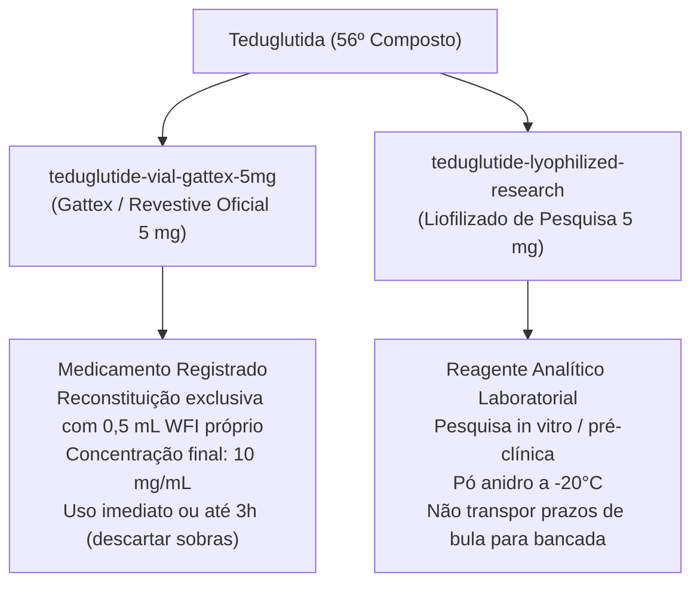

# PeptiPedia — Dossiê Científico e Farmacológico da Teduglutida (56º Composto)

**Data da Publicação:** 18 de outubro de 2026  
**Identificador Canônico:** `teduglutide`  
**Nome Oficial:** Teduglutida  
**Nomes Comerciais de Referência:** Gattex® (EUA / FDA NDA 203441), Revestive® (Europa / EMA e Brasil / Anvisa Registro MS 1.0639.0270)  
**Categoria no Catálogo:** *Regeneração & Tecidos*  
**Estrutura de Apresentação:** Sistema Multiformulação (2 formulações documentadas)  
**Formulação Primária:** `teduglutide-vial-gattex-5mg`

---

## 1. Identidade Química e Mecanismo de Ação

### 1.1. Estrutura Química e Racional Farmacotécnico
A Teduglutida é um análogo peptídico recombinante de 33 aminoácidos de comprimento, derivado do Peptídeo Semelhante ao Glucagon 2 (GLP-2) endógeno humano.
- **Fórmula Molecular / Peso Molecular:** 3752,1 g/mol.
- **Sequência de Aminoácidos:** Modificação pontual fundamental na posição 2 da cadeia: substituição da L-alanina natural por L-glicina (`[Gly2]GLP-2`).
- **Racional Biológico:** O GLP-2 endógeno humano nativo possui uma meia-vida ultracurta (inferior a 7 minutos) devido à clivagem proteolítica imediata pela enzima dipeptidil peptidase-4 (DPP-4) na ligação Ala2-Asp3. A substituição estérica pela glicina confere resistência enzimática à DPP-4, prolongando a meia-vida plasmática de eliminação para ~2 horas em humanos, permitindo posologia subcutânea diária em dose única.

### 1.2. Mecanismo de Ação Celular e Efeito Intestinotrófico
1. **Ativação Receptorial Seletiva:** A teduglutida liga-se com alta afinidade e especificidade ao receptor de GLP-2 (GLP-2R), um receptor transmembrana de 7 domínios acoplado à proteína heterotrimérica Gs, expresso primariamente em células enteroendócrinas, miofibroblastos subepiteliais e neurônios do plexo entérico.
2. **Cascata Intracelular e Sinalização Parácrina:** A ativação do GLP-2R estimula a adenilato ciclase, elevando os níveis intracelulares de AMP cíclico (cAMP) e ativando a proteína quinase A (PKA). Essa via induz a secreção local de mediadores parácrinos tróficos essenciais:
   - **Fator de Crescimento Semelhante à Insulina 1 (IGF-1):** Promove proliferação celular nas criptas intestinais e inibe a apoptose fisiológica dos enterócitos nas pontas das vilosidades;
   - **Fator de Crescimento de Queratinócitos (KGF):** Estimula a reconstituição da barreira epitelial;
   - **Óxido Nítrico Endotelial (eNOS):** Promove vasodilatação microvascular mesentérica, aumentando o fluxo sanguíneo submucoso.
3. **Desfecho Estrutural e Funcional:** Aceleração da hiperplasia mucosa, traduzida clinicamente em aumento significativo da profundidade das criptas, da altura das vilosidades intestinais e da densidade de transportadores dependentes de sódio (SGLT-1), resultando em aumento marcante na absorção transmucosa de água, eletrólitos, lipídios e macronutrientes.

---

## 2. Alertas Críticos de Segurança e Advertências Regulatórias (FDA / EMA / Anvisa)

> [!WARNING]
> **AVISO DE SEGURANÇA SOBRE PÓLIPOS E NEOPLASIAS GASTROINTESTINAIS**
> Por exercer ação trófica e mitogênica potente sobre o epitélio do trato gastrointestinal, a teduglutida possui potencial farmacodinâmico de acelerar o crescimento de displasias e neoplasias pré-existentes.
> - **Colonoscopia Prévia Mandatória:** Antes de iniciar a terapia com teduglutida, é obrigatória a realização de colonoscopia diagnóstica com polipectomia completa em pacientes com remanescente de cólon.
> - **Vigilância Periódica:** Colonoscopia de acompanhamento é recomendada ao término do primeiro ano de tratamento e subsequentemente a cada 5 anos (ou em intervalos mais curtos caso sejam detectados novos pólipos).
> - **Contraindicação em Neoplasia Maligna Ativa:** Contraindicado em pacientes com histórico recente ou confirmação diagnóstica de câncer gastrointestinal, biliar ou pancreático. Em caso de diagnóstico de malignidade ativa durante o uso, a terapia deve ser imediatamente suspensa.

### 2.1. Outras Reações Adversas e Monitoramento Clínico
- **Obstrução Intestinal:** Devido à hipertrofia e estenose mucosa ou pólipos benignos; em caso de dor abdominal intensa e parada de eliminação de gases/fezes, o medicamento deve ser interrompido e o paciente avaliado cirurgicamente.
- **Distúrbios Hepatobiliares e Pancreáticos:** Casos de colecistite, colangite e pancreatite aguda foram relatados; monitorar enzimas pancreáticas (amilase e lipase) e perfil hepático basal e periódico.
- **Sobrecarga Hídrica e Descompensação Cardíaca:** O aumento súbito e expressivo da capacidade de absorção enteral de fluidos e sódio pode precipitar hipervolemia, insuficiência cardíaca congestiva ou edema periférico agudo se o volume de suporte parenteral não for prontamente titulado e reduzido pela equipe clínica.

---

## 3. Protocolos de Reconstituição e Posologia

### 3.1. Posologia Regulatória de Bula
- **Dose Padrão:** 0,05 mg/kg de peso corporal administrada uma vez ao dia por via subcutânea (abdômen, coxa ou braço).
- **Ajuste em Insuficiência Renal:** Em pacientes com insuficiência renal moderada a grave (clearance de creatinina < 50 mL/min) ou em hemodiálise, a dose diária deve ser reduzida em 50% (0,025 mg/kg/dia).

### 3.2. Diferenciação Farmacotécnica entre Apresentações no PeptiPedia

#### Apresentação 1: Gattex® / Revestive® 5 mg Frasco Liofilizado Oficial
- **ID:** `teduglutide-vial-gattex-5mg`
- **Tipo:** `lyophilized_vial` / `isReconstitutionVial: true` / `nominalVialMg: 5`
- **Diluente Oficial:** 0,5 mL de Água Estéril para Injeção (WFI) isenta de conservantes fornecida pelo próprio fabricante em seringa pré-preenchida.
- **Instruções de Manipulação:** Injetar os 0,5 mL de WFI lentamente pela parede interna do frasco; não agitar vigorosamente para evitar desnaturação proteica; rolar gentilmente o frasco entre as palmas das mãos até dissolução completa.
- **Estabilidade:** Frasco fechado estável até a validade mantido entre 2°C e 25°C. Administrar imediatamente após reconstituição ou em até 3 horas mantido até 25°C. Frasco de dose única: descartar qualquer fração remanescente (sem conservantes antimicrobianos).

#### Apresentação 2: Teduglutida Frasco Liofilizado de Pesquisa (5 mg)
- **ID:** `teduglutide-lyophilized-research`
- **Tipo:** `lyophilized_vial` / `isReconstitutionVial: true` / `nominalVialMg: 5`
- **Contexto:** Reagente de síntese para experimentação in vitro e modelos animais.
- **Ressalva Operacional:** Não possui validação farmacopeica ICH Q1A nem certificação estéril para infusão humana. A calculadora de reconstituição do PeptiPedia pode ser utilizada para cálculos matemáticos de diluição de bancada, sem recomendação de autoadministração clínica.

---

## 4. Integração com a Calculadora de Reconstituição

Quando o usuário aciona o botão *"Carregar massa (5 mg) na calculadora"* em qualquer uma das formulações liofilizadas da Teduglutida:
1. O campo `vialMg` da calculadora é pré-preenchido com exatamente **5.0 mg**;
2. Os campos de diluente e dose desejada são limpos ativamente para evitar contaminação por valores preexistentes;
3. O validador numérico estrito `Number.isFinite()` processa as entradas com 100% de segurança matemática.

---

## 5. Conclusão da Documentação

A inclusão da Teduglutida como 56º composto consolida o PeptiPedia como uma base científica de excelência, retratando tanto medicamentos recombinantes aprovados de alta complexidade regulatória quanto insumos de pesquisa, sempre fornecendo aos profissionais de saúde, pesquisadores e comunidade científica informações precisas, rastreáveis e baseadas em evidências sólidas.
