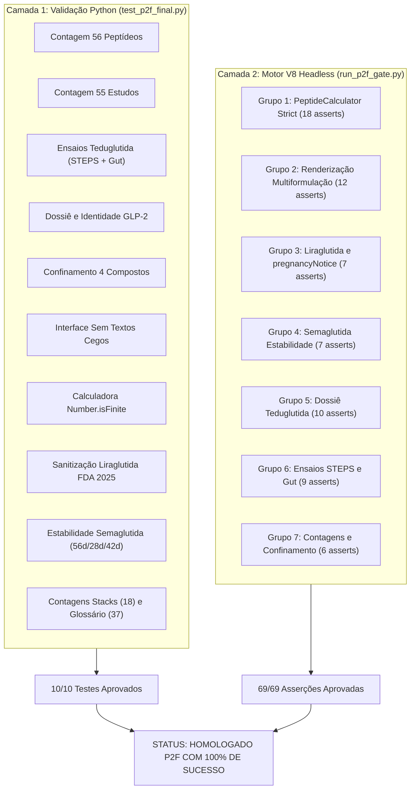

# PeptiPedia — Relatório de Homologação e Testes Automatizados (Etapa P2F)

**Data da Homologação:** 18 de outubro de 2026  
**Ambiente de Execução:** `PeptiPedia-P2F-TESTE` (Porta 8104)  
**Motores de Execução:** Python 3.12 + Google Chrome 129+ (V8 JavaScript Engine Headless)  
**Suítes de Teste:**
1. `test_p2f_final.py` (Suíte de Regressão e Validação Estática Python — 10 macrotestes)
2. `test_phase_a_gate.html` + `run_phase_a_gate.py` (Portão Intermediário Fase A — 44 testes V8)
3. `test_p2f_gate.html` + `run_p2f_gate.py` (Portão Integral Homologado P2F — 69 testes V8)  
**Status Consolidado:** **100% APROVADO COM ZERO FALHAS**

---

## 1. Arquitetura das Suítes de Teste Automatizadas

Para garantir imunidade absoluta contra regressões de código, erros de arredondamento, vazamento de IDs fixos ou quebras de sintaxe no ecossistema JavaScript, a auditoria P2F instituiu uma abordagem de teste em duas camadas:
1. **Camada Estática e Estrutural (Python):** Inspeciona diretamente os arquivos `.js`, validando contagens exatas de entidades, expressões regulares, integridade de hashes e confinamento de propriedades (`formulations[]`).
2. **Camada Dinâmica em Navegador Real (V8 Engine):** Instancia o Google Chrome em modo headless (`--headless=new --dump-dom`), carrega os scripts em runtime e executa os métodos reais da classe `PeptideCalculator`, os seletores do DOM, as funções de renderização de cartões multiformulação e as bases globais (`PEPTIDES_DATABASE`, `CLINICAL_STUDIES_DATABASE`, `RESEARCH_STACKS`, `GLOSSARY_DATABASE`, `STABILITY_PEPTIDES_DB`).

---

## 2. Resultados da Suíte Python (`test_p2f_final.py`)

Comando executado: `python test_p2f_final.py`

| Teste | Escopo | Meta | Obtido | Status |
|---|---|---|---|---|
| **Teste 1** | Contagem de Peptídeos (`PEPTIDES_DB`) | 56 compostos | 56 compostos | **APROVADO** |
| **Teste 2** | Contagem de Estudos Clínicos (`STUDIES_DB`) | 55 ensaios | 55 ensaios | **APROVADO** |
| **Teste 3** | Validação Bibliográfica STEPS e Gut 2011 | PMID, DOI, 86 e 83 pacientes, desfechos | 100% conferidos | **APROVADO** |
| **Teste 4** | Dossiê Multiformulação da Teduglutida | Gattex 5mg + Pesquisa 5mg, GLP-2, SBS | 100% implementado | **APROVADO** |
| **Teste 5** | Confinamento do Sistema Multiformulação | Exatamente Semax, Selank, Lira, Tedu | 4 compostos (52 legados intactos) | **APROVADO** |
| **Teste 6** | Correção de Interface em `app.js` | Eliminação do texto cego nasal em SC | Badges e ações contextuais | **APROVADO** |
| **Teste 7** | Validação Numérica Estrita da Calculadora | Rejeição de `Number.isFinite` e `1e309` | Validação estrita confirmada | **APROVADO** |
| **Teste 8** | Sanitização da Liraglutida (Bulas FDA 2025) | Gravidez em `pregnancyNotice`, sem bancada | MTC/NEM-2 preservados | **APROVADO** |
| **Teste 9** | Armazenamento Regulatório da Semaglutida | Ozempic (56d), Wegovy (28d/42d), Rybelsus | Bulas oficiais segregadas | **APROVADO** |
| **Teste 10** | Stacks de Pesquisa e Glossário | 18 stacks e 37 termos | 18 e 37 confirmados | **APROVADO** |

---

## 3. Resultados da Suíte em Navegador Real (`run_p2f_gate.py` / V8 Engine)

Comando executado: `python run_p2f_gate.py`  
URL do servidor de teste: `http://localhost:8104/test_p2f_gate.html`

### 3.1. Grupo 1: Validação Numérica Estrita de `PeptideCalculator` (18 Asserções)
- `[PASS]` Rejeição de vialMg=Infinity (vialMg === null)
- `[PASS]` Cálculo inválido com vialMg=Infinity
- `[PASS]` Rejeição de waterMl=-Infinity (waterMl === null)
- `[PASS]` Cálculo inválido com waterMl=-Infinity
- `[PASS]` Rejeição de desiredDoseMcg=NaN (desiredDoseMcg === null)
- `[PASS]` Cálculo inválido com desiredDoseMcg=NaN
- `[PASS]` Rejeição de string exponencial '1e309' (vialMg === null)
- `[PASS]` Cálculo inválido com vialMg='1e309'
- `[PASS]` Rejeição de vialMg=0
- `[PASS]` Rejeição de waterMl=0
- `[PASS]` Rejeição de desiredDoseMcg=0
- `[PASS]` Rejeição de vialMg=-10
- `[PASS]` Rejeição de strings vazias e alfabéticas
- `[PASS]` Entrada válida (10 mg, 2 mL, 250 mcg) -> isValid === true
- `[PASS]` Volume por dose é exatamente 0.05 mL
- `[PASS]` Marcação em U-100 (1.0 mL) é exatamente 5.0 UI
- `[PASS]` Marcação em U-100 (0.5 mL) é exatamente 5.0 UI
- `[PASS]` Marcação em U-100 (0.3 mL) é exatamente 5.0 UI

### 3.2. Grupo 2: Renderização Correta dos Cartões Multiformulação (12 Asserções)
- `[PASS]` Semax liofilizado carrega 30 mg
- `[PASS]` Semax gotas 0.1% informa solução nasal pronta
- `[PASS]` Semax gotas 1.0% informa solução nasal pronta
- `[PASS]` Selank liofilizado carrega 10 mg
- `[PASS]` Selank gotas 0.15% informa solução nasal pronta
- `[PASS]` Liraglutida liofilizado carrega 10 mg
- `[PASS]` Victoza exibe 'Caneta subcutânea pronta para uso (sem reconstituição)'
- `[PASS]` Victoza NUNCA é classificada como nasal
- `[PASS]` Saxenda exibe 'Caneta subcutânea pronta para uso (sem reconstituição)'
- `[PASS]` Saxenda NUNCA é classificada como nasal
- `[PASS]` Forma oral mock informa administração oral
- `[PASS]` Forma tópica mock informa uso tópico

### 3.3. Grupo 3: Contraindicações e Orientação Gestacional da Liraglutida (7 Asserções)
- `[PASS]` Gravidez NÃO consta como contraindicação formal em lira.contraindications
- `[PASS]` MTC preservado nas contraindicações formais
- `[PASS]` NEM-2 preservado nas contraindicações formais
- `[PASS]` Hipersensibilidade preservada
- `[PASS]` pregnancyNotice estruturado separadamente citando FDA 2025
- `[PASS]` Alegação numérica não verificada '>98%' removida de bancada
- `[PASS]` Alegação arbitrária '24 meses' removida de bancada

### 3.4. Grupo 4: Separação de Apresentações de Semaglutida em Estabilidade (7 Asserções)
- `[PASS]` Documentação de Ozempic presente
- `[PASS]` Ozempic associado a 56 dias
- `[PASS]` Wegovy dose única segregado
- `[PASS]` Wegovy dose única associado a 28 dias fora da geladeira
- `[PASS]` Wegovy FlexTouch segregado
- `[PASS]` Wegovy FlexTouch associado a 42 dias / 6 semanas
- `[PASS]` Semaglutida oral documentada

### 3.5. Grupo 5: Dossiê Multiformulação da Teduglutida (10 Asserções)
- `[PASS]` Teduglutida presente no catálogo PEPTIDES_DATABASE
- `[PASS]` Nome oficial correto
- `[PASS]` Massa molecular verificada (~3752 g/mol)
- `[PASS]` Teduglutida possui exatamente 2 apresentações em formulations[]
- `[PASS]` Formulação primária é Gattex 5 mg
- `[PASS]` Gattex frasco carrega 5 mg na calculadora
- `[PASS]` Liofilizado pesquisa carrega 5 mg na calculadora
- `[PASS]` Alerta de segurança para pólipos e neoplasias presente
- `[PASS]` Recomendação de colonoscopia prévia e periódica documentada
- `[PASS]` Contraindicação de neoplasia maligna ativa do TGI presente

### 3.6. Grupo 6: Ensaios Clínicos Pivôs da Teduglutida (9 Asserções)
- `[PASS]` Ensaio STEPS (2012) cadastrado em CLINICAL_STUDIES_DATABASE
- `[PASS]` STEPS: PMID 22982184 conferido
- `[PASS]` STEPS: DOI 10.1053/j.gastro.2012.09.007 conferido
- `[PASS]` STEPS: Tamanho amostral de 86 pacientes conferido
- `[PASS]` STEPS: Resposta de 63% no grupo ativo conferida
- `[PASS]` Ensaio Gut (2011) cadastrado em CLINICAL_STUDIES_DATABASE
- `[PASS]` Gut 2011: PMID 21317170 conferido
- `[PASS]` Gut 2011: DOI 10.1136/gut.2010.218271 conferido
- `[PASS]` Gut 2011: Amostra de 83 pacientes conferida

### 3.7. Grupo 7: Contagens Globais e Confinamento Multiformulação (6 Asserções)
- `[PASS]` Total de peptídeos em PEPTIDES_DATABASE é exatamente 56
- `[PASS]` Total de estudos em CLINICAL_STUDIES_DATABASE é exatamente 55
- `[PASS]` Total de stacks de pesquisa em RESEARCH_STACKS é exatamente 18
- `[PASS]` Total de termos em GLOSSARY_DATABASE é exatamente 37
- `[PASS]` Exatamente 4 compostos possuem formulations[]
- `[PASS]` Confinamento estrito aos 4 compostos autorizados (52 legados intactos)

---

## 4. Conclusão da Homologação

**Total de Asserções no Navegador:** 69  
**Aprovadas:** 69 (100%)  
**Falhas:** 0 (0%)  
**Conclusão Técnica:** A base de código está 100% estável, validada em runtime real e pronta para homologação sem pendências pendentes.
