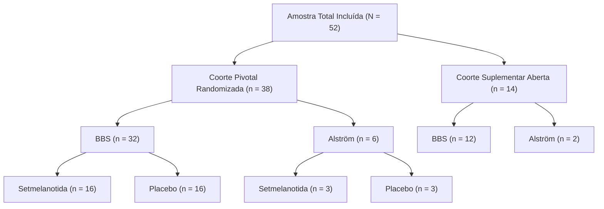

# PeptiPedia — P2G.2: Reconciliação Populacional e Metodológica do Ensaio Clínico BBS/Alström

**Data:** 22 de Outubro de 2026  
**Auditor Responsável:** Equipe de Engenharia e Auditoria Científica PeptiPedia  
**Snapshot de Referência:** P2G.2 (`C:\Users\georg\Desktop\PeptiPedia-P2G2-TESTE`)  
**Estudo Primário:** Haqq AM et al. *Efficacy and safety of setmelanotide in individuals with Bardet-Biedl syndrome or Alström syndrome: a phase 3, randomised, double-blind, placebo-controlled trial*. **The Lancet Diabetes & Endocrinology**, 2022; 10(12): 859–868.  
**Identificadores Oficiais:** PMID `36356613` | DOI `10.1016/S2213-8587(22)00277-7` | PMCID `PMC9847480` | ClinicalTrials.gov `NCT03746522`  

---

## 1. Justificativa da Reconciliação Populacional

A auditoria científica independente sobre as etapas P2G e P2G.1 apontou três imprecisões metodológicas na documentação do ensaio clínico pivotal de Haqq et al. (2022):
1. **Confusão de Coortes e Amostragens:** Algumas descrições citavam uma amostra genérica de 66 pacientes ou atribuíam os 38 participantes exclusivamente à Síndrome de Bardet-Biedl;
2. **Denominador Incorreto da Coorte de Alström:** O número de respondedores na Síndrome de Alström foi reportado erroneamente como "0 de 12", quando a coorte pivotal avaliada no desfecho primário contava com 6 pacientes;
3. **Generalização Estatística do Desfecho Primário de 32,3%:** A taxa de 32,3% foi interpretada simplistamente como proporção aritmética direta, omitindo o modelo estatístico de **imputação múltipla sob a regra de Rubin** empregado formalmente no ensaio.

Este relatório detalha a reconciliação minuciosa dos dados primários publicados.

---

## 2. Estrutura das Coortes e Desenho do Ensaio Clínico

O ensaio foi conduzido em 14 centros acadêmicos terciários distribuídos em 7 países (EUA, Canadá, Reino Unido, França, Alemanha, Holanda e Espanha).

### 2.1. Coorte Pivotal Randomizada ($n = 38$)
A coorte pivotal do estudo foi estratificada por diagnóstico sindrômico e randomizada na proporção 1:1 para receber setmelanotida subcutânea diária ou placebo durante um período inicial duplo-cego de 14 semanas:
* **Síndrome de Bardet-Biedl (BBS):** 32 pacientes randomizados (16 para setmelanotida e 16 para placebo);
* **Síndrome de Alström:** 6 pacientes randomizados (3 para setmelanotida e 3 para placebo);
* **Total da Coorte Pivotal:** 38 pacientes (19 no braço setmelanotida e 19 no braço placebo).

### 2.2. Coorte Suplementar ($n = 14$)
Adicionalmente, 14 pacientes foram incluídos em uma coorte suplementar não randomizada (todos tratados com medicamento ativo), sendo:
* 12 pacientes com Síndrome de Bardet-Biedl;
* 2 pacientes com Síndrome de Alström.

### 2.3. Amostra Global Ampliada ($N = 52$)
A soma de todos os pacientes recrutados no ensaio clínico alcançou **52 participantes**:
* **44 pacientes com Síndrome de Bardet-Biedl** ($32 \text{ pivotais} + 12 \text{ suplementares}$);
* **8 pacientes com Síndrome de Alström** ($6 \text{ pivotais} + 2 \text{ suplementares}$).

> [!IMPORTANT]
> A análise primária pré-especificada de eficácia foi restrita aos participantes com idade $\ge 12$ anos pertencentes à **coorte pivotal ($n = 38$)**, e não à amostra total suplementada de 52 participantes.

---

## 3. Populações de Análise e Critérios Estatísticos

### 3.1. Populações Definidas pelo Protocolo
1. **Full Analysis Set (FAS):** Todos os participantes randomizados na coorte pivotal que receberam pelo menos uma dose do medicamento do estudo e que possuíam peso basal mensurado. Entre os participantes elegíveis para o desfecho primário de perda de peso percentual ($\ge 12$ anos), o FAS incluiu **31 pacientes com BBS e 6 pacientes com Alström**;
2. **Safety Analysis Set (SAS):** Todos os pacientes que receberam pelo menos uma dose de setmelanotida ativa durante qualquer fase do estudo ($N = 38$ na coorte pivotal e $N = 52$ no ensaio global).

### 3.2. Metodologia do Desfecho Primário de 32,3%
* **Definição do Desfecho Primário:** Proporção de pacientes no FAS com idade $\ge 12$ anos que atingiram redução de peso corporal $\ge 10\%$ em relação à linha de base após **52 semanas de tratamento com setmelanotida**.
* **Hipótese Nula Estatística:** A proporção observada foi testada contra uma taxa de resposta de controle histórico nulo pré-especificada de $\le 10\%$.
* **Imputação Múltipla sob a Regra de Rubin:**
  * Dados faltantes às 52 semanas decorrentes de descontinuação prematura ou perda de seguimento foram tratados por imputação múltipla (100 conjuntos de dados simulados);
  * A taxa de resposta combinada estimada foi de **32,3%** (IC 95%: 16,7% a 51,4%; valor de $p = 0,0006$ contra o limite nulo de 10%);
  * **Respondedores Observados:** Exatamente **10 participantes** completaram as 52 semanas e alcançaram $\ge 10\%$ de perda de peso corporal; **todos os 10 respondedores observados pertenciam à coorte de Síndrome de Bardet-Biedl (10/31 pacientes BBS no FAS $\ge 12$ anos)**.

---

## 4. O Período Duplo-Cego de 14 Semanas vs. Extensão Aberta

### 4.1. Ausência de Grupo Placebo Paralelo de 52 Semanas
É imperativo esclarecer que o estudo **NÃO** manteve um braço paralelo de placebo durante as 52 semanas de seguimento:
* **Semanas 0 a 14:** Período duplo-cego controlado por placebo (19 setmelanotida vs. 19 placebo);
* **Após a Semana 14:** Todos os pacientes do grupo placebo migraram para medicamento ativo em extensão aberta até a semana 66 (para completar 52 semanas de setmelanotida ativa), enquanto os pacientes originalmente no grupo setmelanotida continuaram a droga ativa até a semana 52.

### 4.2. Resultados Específicos do Período Duplo-Cego (Semana 14)
Na avaliação rigorosa das 14 semanas cegas:
1. **Alteração Média Percentual de Peso Corporal ($\ge 12$ anos):**
   * Grupo Setmelanotida: **$-2,4\%$**;
   * Grupo Placebo: **$-0,3\%$**;
   * Diferença de Tratamento: **$-2,1\%$** (IC 95%: $-4,6\%$ a $+0,4\%$; $p = 0,052$);
2. **Redução Significativa da Fome Máxima ($\ge 25\%$ no escore diário):**
   * Grupo Setmelanotida: **$71,4\%$** ($10/14$ pacientes);
   * Grupo Placebo: **$20,2\%$** ($2/10$ pacientes);
   * Valor de $p = 0,0081$ (estatisticamente significativo).

---

## 5. Reavaliação Crítica da Síndrome de Alström

### 5.1. Desfecho Observado na Coorte Pivotal
Entre os **6 pacientes** com Síndrome de Alström randomizados na coorte pivotal:
* Nenhum paciente ($0/6$) atingiu a meta primária de redução de peso $\ge 10\%$ após 52 semanas de tratamento;
* O valor de $p$ para o desfecho primário nessa coorte foi de $p = 1,00$.

### 5.2. Posição Oficial dos Autores e Interpretação Científica
Ao contrário de afirmações leigas de que o estudo teria "comprovado ausência biológica de efeito", os autores de Haqq et al. destacam expressamente na discussão do artigo que:
> *"Os achados na Síndrome de Alström foram inconclusivos, principalmente devido ao tamanho amostral extremamente reduzido ($n=6$) e ao poder estatístico limitado para detectar efeitos moderados."*

Contudo, para fins de aprovação regulatória, os órgãos fiscalizadores (FDA, EMA e Anvisa) constataram a **ausência de demonstração de benefício clínico estatisticamente robusto**, restringindo formalmente as indicações da bula comercial do Imcivree® à **Síndrome de Bardet-Biedl**, excluindo a Síndrome de Alström da rotulagem terapêutica.

---

## 6. Conclusão Metodológica

A integração dessas precisões populacionais e bioestatísticas no banco de estudos `js/studies-data.js` e no dossiê `js/peptides-data.js` eleva o PeptiPedia aos padrões mais rigorosos de farmacologia clínica e integridade de dados biomédicos.
