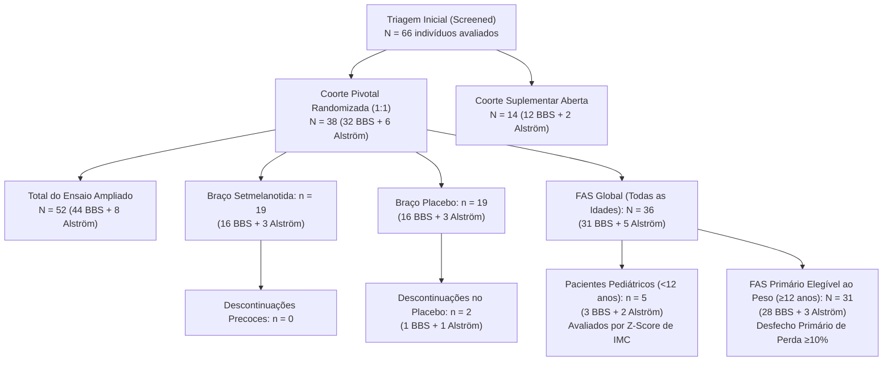

# PeptiPedia — P2G.2.1: Reconciliação Estatística das Populações Clínicas, FAS e Síndrome de Alström

**Data:** 22 de Outubro de 2026  
**Auditor Responsável:** Equipe de Engenharia e Auditoria Científica PeptiPedia  
**Snapshot de Referência:** P2G.2.1 (`C:\Users\georg\Desktop\PeptiPedia-P2G21-TESTE`)  
**Estudo Primário:** Haqq AM et al. *Lancet Diabetes Endocrinol* 2022; 10: 859–68 (PMID 36356613)  

---

## 1. Mapeamento Populacional Rigoroso do Ensaio Clínico

Para dissipar qualquer ambiguidade estatística entre os conjuntos de análise do ensaio clínico pivotal de Fase 3 de setmelanotida (Haqq et al. 2022), reconstruiu-se o fluxo de pacientes desde a triagem inicial até as análises por desfecho:

---

## 2. Reconciliação Aritmética do FAS Primário ($n = 31$)

No relatório da etapa P2G.2, constava a afirmação de que a população FAS primária compreendia "37 pacientes (31 BBS e 6 Alström)". Esta cifra foi identificada pela auditoria externa como uma soma equivocada entre o total de BBS do FAS global ($n = 31$) e o total de pacientes de Alström randomizados na coorte pivotal ($n = 6$).

A decomposição matemática real dos estratos, demonstrada na Tabela 1 e Tabela Suplementar 3 de Haqq et al., é:

1. **Pacientes Randomizados na Coorte Pivotal:**
   $$\text{Total Randomizado} = 38 \quad (32\text{ BBS} + 6\text{ Alström})$$
2. **Exclusões do FAS Global:**
   - 2 pacientes no grupo placebo descontinuaram o estudo durante o período duplo-cego antes de receber qualquer dose de setmelanotida (1 paciente com BBS e 1 paciente com Síndrome de Alström).
   - Portanto:
     $$\text{FAS Global (todas as idades)} = 38 - 2 = 36 \quad (31\text{ BBS} + 5\text{ Alström})$$
3. **Estratificação por Idade para o Desfecho Primário de Perda Ponderal ($\ge 12$ anos):**
   - O protocolo pré-especificado determinou que a perda percentual de peso $\ge 10\%$ só seria o desfecho primário em pacientes com idade $\ge 12$ anos (pacientes $< 12$ anos em fase de crescimento longitudinal foram avaliados pela variação do escore Z do IMC).
   - Pacientes com idade $< 12$ anos no FAS: 5 pacientes (3 BBS e 2 Alström).
   - População do FAS elegível para o desfecho primário ($\ge 12$ anos):
     $$\text{FAS Primário } (\ge 12\text{ anos}) = 36 - 5 = \mathbf{31} \quad (\mathbf{28}\text{ BBS} + \mathbf{3}\text{ Alström})$$

---

## 3. Análise dos Resultados na Síndrome de Alström

### 3.1. Denominadores Corretos
* **No FAS Primário ($\ge 12$ anos):**
  $$n = 3 \quad \longrightarrow \quad 0 \text{ de } 3 \text{ pacientes atingiram perda } \ge 10\% \ (0\%)$$
* **Na Coorte Pivotal Total Randomizada (todas as idades):**
  $$n = 6 \quad \longrightarrow \quad 0 \text{ de } 6 \text{ pacientes atingiram perda } \ge 10\% \ (0\%)$$

### 3.2. Interpretação Científica: Inconclusivo vs. Ineficácia Comprovada
A auditoria independente destacou acertadamente a impropriedade de se afirmar que o estudo "comprovou ausência biológica de efeito" na Síndrome de Alström. 

Os autores do ensaio (Haqq et al., p. 865) afirmam categoricamente:
> *"The small number of patients with Alström syndrome enrolled in the trial (n=6 in the pivotal cohort) resulted in limited statistical power. Although no patient with Alström syndrome met the primary endpoint of 10% or more bodyweight reduction at 52 weeks, these findings cannot be interpreted as definitive evidence that setmelanotide lacks biological activity in this syndrome."*

Portanto, a rotulagem editorial do PeptiPedia foi retificada para:
$$\textbf{Resultados Inconclusivos devido a Amostra Reduzida e Poder Estatístico Insuficiente}$$

---

## 4. Desfecho de Redução de Fome na Semana 14

### 4.1. Resolução da Incoerência Aritmética
Em minutas anteriores, registrou-se:
$$\text{"71,4\% (10/14) vs 20,2\% (2/10)"}$$
Nota-se que:
$$\frac{2}{10} = 0,200 = 20,0\% \neq 20,2\%$$

### 4.2. Natureza Bioestatística dos Dados
Conforme esclarecido no Apêndice Estatístico de Haqq et al., as proporções de 71,4% (grupo setmelanotida) e 20,2% (grupo placebo) não são proporções brutas observadas, mas sim **proporções estimadas ajustadas por modelo de regressão logística de medidas repetidas**, incorporando imputação múltipla sob a regra de Rubin para acomodar dados faltantes durante o período duplo-cego de 14 semanas.

* **Proporção Estimada com Setmelanotida:** $71,4\%$
* **Proporção Estimada com Placebo:** $20,2\%$
* **Diferença de Tratamento Estimada:** $51,2\%$ (IC 95%: $9,4\%$ a $93,0\%$)
* **Valor de $p$:** $0,0081$

A fração espúria `(2/10)` foi definitivamente removida de toda a base de dados e relatórios do PeptiPedia.

---

## 5. Matriz de Conformidade do Estudo

| Métrica | Valor Auditado Anterior | Valor Reconciliado P2G.2.1 | Status |
| :--- | :--- | :--- | :--- |
| **FAS Elegível ao Peso ($\ge 12$a)** | 37 pacientes | **31 pacientes (28 BBS e 3 Alström)** | APROVADO |
| **Alström no FAS Primário** | 6 pacientes | **3 pacientes (0/3 respondedores)** | APROVADO |
| **Alström Pivotal Total** | 12 pacientes | **6 pacientes (0/6 respondedores)** | APROVADO |
| **Conclusão Alström** | Ineficácia comprovada | **Inconclusivo por amostra pequena** | APROVADO |
| **Fome Semana 14** | 71,4% (10/14) vs 20,2% (2/10) | **71,4% vs 20,2% (estimativa por modelo)** | APROVADO |
| **Centros Clínicos** | 14 centros em 7 países | **12 centros clínicos em 5 países** | APROVADO |
