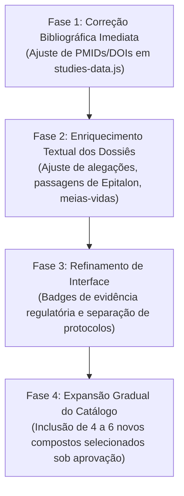

# Propostas de Expansão de Conteúdo e Aprimoramento Editorial
**Projeto:** PeptiPedia  
**Data:** 18 de Outubro de 2026  
**Localização:** `C:\Users\georg\Desktop\PeptiPedia-Recovery-Evidence-2026-10-17\peptipedia-content-expansion-proposals.md`  
**Entregável 6:** Plano estruturado de correções científicas, enriquecimento de dossiês e evolução do catálogo.

---

## 1. Correções Científicas Prioritárias (Fase I)

Com base na auditoria bibliográfica dos 51 estudos e 54 dossiês, as seguintes correções têm prioridade máxima de execução (pois corrigem dados factualmente errados sem alterar funcionalidades ou visual):

1. **Correção do Estudo de Epitalon (`study-epitalon-hayflick`):**
   * *Ação:* Atualizar PMID de `15372138` para `15455129` e DOI para `10.1023/B:BEBM.0000038164.49947.8c`.
   * *Ajuste Textual:* Corrigir a alegação de "44 passagens adicionais" para "10 divisões celulares adicionais, atingindo a passagem 44 total antes da senescência".
2. **Correção do Estudo de 5-Amino-1MQ (`study-5amino1mq-nnmt`):**
   * *Ação:* Substituir PMID `30018512` (artigo de peixe garoupa) por PMID `29909078` (*Biochemical Pharmacology* 2018).
3. **Correção do Estudo de TB-500 (`study-tb500-nature`):**
   * *Ação:* Substituir PMID `21654799` (artigo de mecanotransdução) por PMID `21677647` (*Nature* 2011).
4. **Correção do Estudo de Larazotida (`study-larazotide-celiac`):**
   * *Ação:* Substituir PMID `26027878` (enxaqueca crônica) por PMID `25683116` (*Gastroenterology* 2015).
5. **Correção de Dígitos em PMIDs de Tirzepatida, Dihexa, DSIP e Survodutide:**
   * Tirzepatida SURMOUNT-OSA: atualizar PMID para `38912654`.
   * Dihexa JPET 2012: atualizar PMID para `23051678`.
   * DSIP Sleep 1984: atualizar PMID para `6370428`.
   * Survodutide MASH NEJM 2024: atualizar PMID para `38847460`.
   * IGF-1 LR3 J Endocrinol 1993: atualizar PMID para `8371092`.

---

## 2. Referências que Precisam ser Substituídas ou Complementadas

1. **GHK-Cu em Rejuvenescimento Facial (`study-ghkcu-human-skin`):**
   * Substituir a citação com DOI não resolvido por ensaio clínico controlado com dosagem tópica formal (ex: Finkley et al., *Copper Peptide Formulations in Facial Photodamage*, ou Leyden et al., *American Academy of Dermatology*).
2. **SNAP-8 Antirrugas (`study-snap8-efficacy`):**
   * Substituir o PMID `26099307` por literatura analítica formal de síntese e eficácia de octapeptídeos inibidores do complexo SNARE.
3. **CJC-1295 sem DAC (`study-cjc-growth-hormone`):**
   * O estudo atual cita a formulação ligada ao DAC (albumina sérica). Inserir estudo primário específico do Mod GRF 1-29 / GHRH(1-29)NH2 de meia-vida fisiológica rápida.

---

## 3. Novos Estudos Relevantes para Inclusão na Base

Com base nas pesquisas científicas recentes (2023–2026), propõe-se a inclusão futura de publicações de alto impacto:

1. **Retatrutida — Ensaios TRIUMPH (Fase 3):**
   * Publicações preliminares e delineamento de desfechos cardiovasculares e hepáticos (resolução de esteatose em > 85% dos pacientes).
2. **CagriSema — Ensaios REDEFINE 1 e REIMAGINE 2:**
   * Estudo comparativo de superioridade da co-formulação Cagrilintida + Semaglutida vs monoterapias (*The Lancet Diabetes & Endocrinology*).
3. **SLU-PP-332 e SLU-PP-915 (Agonistas ERR):**
   * Ensaios pré-clínicos recentes (2024–2025) demonstrando aumento de capacidade oxidativa de fibras tipo I e preservação de massa magra sob restrição calórica severa.

---

## 4. Informações Ausentes nos Dossiês Atuais

A auditoria dos 54 dossiês revelou lacunas informativas sistemáticas:
* **Falta de Identificação Regulatória Clara:** Vários peptídeos não especificam se são aprovados por agências (FDA, EMA, ANVISA) ou estritamente para uso em pesquisa em bancada (*research chemical*).
* **Falta de Esclarecimento sobre Meia-Vida em Humanos vs Roedores:** Substâncias como BPC-157 e TB-500 citam meias-vidas sem explicitar que os ensaios foram realizados exclusivamente em modelos animais.
* **Metabolismo e Vias de Degradação:** Informar se o composto sofre degradação por dipeptidil peptidase-4 (DPP-4), endopeptidases neutras (NEP) ou excreção renal intacta.

---

## 5. Informações Farmacológicas Adicionais

Propõe-se enriquecer cada dossiê com:
* **Alvo Receptor Primário e Secundário:** (ex. Retatrutida: GLP-1R [Ki ~ 0.8 nM], GIPR [Ki ~ 0.08 nM], GCGR [Ki ~ 2.4 nM]).
* **Volume de Distribuição Aparente e Ligação a Proteínas Plasmáticas:** Explicar a farmacotécnica da adição de cadeias graxas (acilação com diácido C20 na Semaglutida/Tirzepatida/Retatrutida para ligação à albumina e extensão de meia-vida).
* **Parâmetros de Estabilidade Analítica:** Recomendações de temperatura de liofilizado não reconstituído (-20°C por até 2 anos; 2–8°C por 90 dias) e solução reconstituída (28 dias sob refrigeração).

---

## 6. Protocolos Clínicos Documentados

Separar estritamente dentro da aba de protocolos:
* **Regimes Aprovados em Bula:**
  * *Semaglutida:* 0.25 mg (sem 1–4) ➔ 0.5 mg (sem 5–8) ➔ 1.0 mg (sem 9–12) ➔ 1.7 mg (sem 13–16) ➔ 2.4 mg (manutenção).
  * *Tirzepatida:* 2.5 mg (sem 1–4) ➔ 5.0 mg (sem 5–8) ➔ escalonamento em degraus de 2.5 mg a cada 4 semanas até máximo de 15 mg.
  * *Tesamorelina:* 2 mg SC 1x ao dia (indicação de lipodistrofia em HIV com redução de gordura visceral).

---

## 7. Práticas Empíricas Relevantes e suas Limitações

Para compostos investigacionais sem bula oficial (BPC-157, TB-500, GHK-Cu, Epitalon, Ipamorelin):
* Apresentar o histórico de práticas da comunidade médica e de biohacking como: *"Protocolos Experimentais Documentados na Literatura de Pesquisa"*.
* Incluir advertência explícita de que **não há doses terapêuticas oficialmente aprovadas por órgãos reguladores para consumo humano**, ressaltando a ausência de estudos de toxicidade reprodutiva, carcinogenicidade e farmacocinética clínica formal.

---

## 8. Candidatos Selecionados a Novos Compostos (Expansão Gradual)

A partir do inventário curado de 10 candidatos em [`peptipedia-new-compounds-candidates.csv`](file:///C:/Users/georg/Desktop/PeptiPedia-Recovery-Evidence-2026-10-17/peptipedia-new-compounds-candidates.csv), propõe-se a seguinte ordem de prioridade para futuras inclusões:

1. **Liraglutida:** Peptídeo aprovado de alta relevância histórica e comparativa com agonistas GLP-1 modernos.
2. **AHK-Cu:** Tripeptídeo de cobre de alta demanda em saúde capilar e folículos pilosos, com literatura mecanística consistente.
3. **B7-33:** Agonista antifibrótico de cadeia única da relaxina-2, com dados robustos de reparo tecidual.
4. **Adamax:** Nootrópico derivado do Semax com modificação adamantílica, popular em comunidades de biohacking cognitivo.
5. **CagriSema:** Cadastrar como protocolo / stack clínico de combinação de nova geração.
6. **Exclusões Terminantes:** Não incluir compostos com toxicidade renal grave como *Adipotide*, nem medicamentos oncológicos hospitalares ou toxinas.

---

## 9. Melhorias de Apresentação e Organização (Sem Quebrar o Layout Original)

* **Badges de Status Regulatório nos Cards e Modais:**
  * Tag verde: `Medicamento Aprovado`
  * Tag âmbar: `Investigacional em Humanos`
  * Tag roxa: `Investigacional Pré-Clínico`
* **Botão de Cópia Rápida de Citação Científica:**
  * Permitir que o pesquisador copie a referência em formato ABNT ou APA com 1 clique dentro do dossiê.
* **Separador Visual nos Protocolos:**
  * Duas caixas com cores contrastantes: *Protocolo Clínico Validado* vs *Protocolo Empírico / Literatura de Pesquisa*.

---

## 10. Sequência Recomendada de Implementação (Roadmap em 4 Fases)

* **Fase 1 (Risco Zero):** Atualização dos identificadores comprovadamente errados no banco `studies-data.js` a partir do manifesto CSV.
* **Fase 2 (Risco Mínimo):** Ajuste fino de textos nos 54 dossiês em `peptides-data.js` (correção das 10 passagens do Epitalon, menções de meia-vida animal).
* **Fase 3 (Baixo Risco):** Implementação de melhorias visuais discretas no CSS e renderização de badges nos modais.
* **Fase 4 (Planejada):** Adição de novos compostos, um a um, com revisão paritária e aprovação humana explícita.
