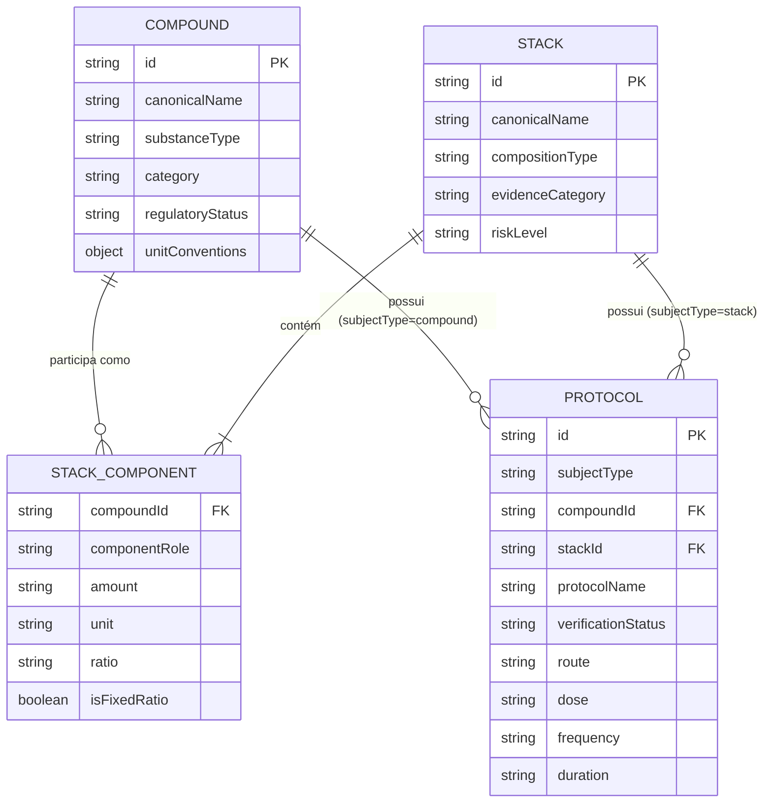

# PLANO DE MIGRAÇÃO E NORMALIZAÇÃO DE DOMÍNIO — FASE H4.5
## Separação Arquitetural das Entidades: Compounds, Stacks e Protocols

**Identificador de Governança:** `PLAN-DOMAIN-MIGRATION-H4.5`  
**Data:** 08 de Novembro de 2026  
**Auditor / Arquiteto Responsável:** Orquestrador Técnico Antigravity  
**Branch de Trabalho:** `architecture/domain-normalization-h4-5`  
**Base de Origem:** Commit `491127e` (`research/stacks-units-expansion-audit`)

---

## 1. DIAGNÓSTICO E JUSTIFICATIVA DA NORMALIZAÇÃO

### 1.1. O Problema do Acoplamento Heterogêneo
No modelo herdado até a fase H4.4:
1. **Compostos continham protocolos embutidos:** O array `PEPTIDES_DATABASE` misturava dados intrínsecos da molécula (fórmula, peso molecular, sequência, alvo terapêutico) com dados posológicos e de reconstituição (`researchProtocols`, `structuredProtocols`, `reconstitution`). Isso criava a ilusão de que uma molécula possui uma "dose intrínseca única", quando na realidade doses variam radicalmente por indicação, população e via de administração (ex.: Tesamorelina WR 1,28 mg/dia vs. SV 1,4 mg/dia vs. histórica 2,0 mg/dia).
2. **Combinações continham regimes e componentes duplicados:** O array `RESEARCH_STACKS` duplicava nomes, vias e alertas dos compostos, além de embutir o agendamento (`protocolSchedule`) diretamente dentro do objeto de combinação, impedindo a distinção entre a definição do stack (quais substâncias e proporções) e o protocolo de administração (doses, horários, duração e pausas).
3. **Ausência de entidade autônoma para Protocolos:** Não havia como registrar múltiplos protocolos para um mesmo composto (ex.: indicação aprovada pela FDA vs. prática empírica pré-clínica) sem aninhar arrays complexos dentro do cadastro químico.

---

## 2. ESTRATÉGIA DE NORMALIZAÇÃO EM TRÊS ENTIDADES

### 2.1. Regra Fundamental de Relação Unívoca do Protocolo
Todo registro da entidade `Protocols` possui a propriedade discriminadora obrigatória `subjectType`:
- Se `subjectType === 'compound'`: o campo `compoundId` é preenchido com o ID canônico do composto, e `stackId` é estritamente `null`.
- Se `subjectType === 'stack'`: o campo `stackId` é preenchido com o ID canônico do stack, e `compoundId` é estritamente `null`.
- É **estruturalmente proibido** um protocolo possuir simultaneamente `compoundId` e `stackId`, ou não possuir nenhum dos dois.

---

## 3. MAPEAMENTO E CONCILIAÇÃO DOS DADOS ORIGINAIS

### 3.1. Compostos (114 registros)
- **Origem:** `PEPTIDES_DATABASE` (114 itens em `js/peptides-data.js`) cruzado com `MATRIZ_114_UNIDADES_FARMACOLOGICAS.csv`, `MATRIZ_114_AUDITORIA_CIENTIFICA.csv` e `MANIFESTO_114_RECONCILIADO.csv`.
- **Destino:** `COMPOUNDS_STORE` em `js/domain/compounds.js` (e espelho em `public/`).
- **Preservação:** 100% dos IDs originais preservados sem nenhuma alteração. Inclusão explícita de `substanceType` (peptídeo sintético, proteína recombinante, análogo peptídico, agonista de pequena molécula, extrato biológico heterólogo).

### 3.2. Stacks (Combinações canônicas)
- **Origem:** 18 stacks do `RESEARCH_STACKS` da H4.4 + inventário ampliado da H4.4 (`INVENTARIO_AMPLIADO_STACKS.csv` com 19 registros) + `LISTA_STACKS_NOVOS_GRAUS.csv` (12 novos).
- **Conciliação e Eliminação de Duplicatas:**
  - `wound-scar-tissue-stack` da base original foi formalmente identificado e unificado com o blend comunitário `glow-stack` (GHK-Cu + BPC-157 + TB-500 em razão 5:1:1), mantendo alias histórico.
  - `metabolic-extreme-stack` da base original (Tirzepatide + Cagrilintide) é segregado da coformulação clínica oficial `cagrisema-combination` (Semaglutide + Cagrilintide).
  - Stacks novos mapeados na H4.4 (ex.: KLOW, KLOW modificado com LL-37, HGH Bridge, Tesamorelin+Ipamorelin, MOTS-c+5-Amino-1MQ, PT-141+Kisspeptin-10) são integrados com IDs estáveis.
- **Destino:** `STACKS_STORE` em `js/domain/stacks.js`.
- **Isolamento de Dados:** Os stacks passam a conter apenas referências por `compoundId`, sem duplicar dados químicos ou docstrings das moléculas individuais.

### 3.3. Protocolos
- **Origem:**
  1. Protocolos individuais de compostos extraídos de `researchProtocols`, `structuredProtocols` e `reconstitution` dos 114 compostos.
  2. Protocolos de combinação extraídos de `protocolSchedule` dos stacks.
- **Destino:** `PROTOCOLS_STORE` em `js/domain/protocols.js`.
- **Estratificação por Status de Verificação:**
  - `regulatory_approved`: Bulas oficiais FDA/Anvisa (ex.: Egrifta WR, Egrifta SV, Vyleesi, Humatrope, Ozempic, Mounjaro).
  - `clinical_trial`: Ensaios clínicos controlados de fase 2/3 (ex.: CagriSema REDEFINE, MMPOWER-3 de SS-31, TRIUMPH de Retatrutide).
  - `off_label_medical`: Protocolos médicos documentados em literatura clínica especializada.
  - `preclinical_empirical`: Extrapolações alométricas baseadas em modelos animais (ex.: BPC-157 10 mcg/kg em roedores).
  - `community_unvalidated`: Relatos de biohacking e fóruns de musculação.
  - `contraindicated`: Combinações perigosas expressamente desaconselhadas (ex.: Incretin Triple Burn).

---

## 4. ESTRATÉGIA DE COMPATIBILIDADE E RETROCOMPATIBILIDADE

Para garantir que nenhuma interface visual (`js/app.js`, filtros, modal de dossiês, calculadora, relógio de estabilidade) ou teste de regressão existente seja quebrado:

1. **Camada de Adaptação Canônica:**
   - O arquivo `js/domain/index.js` expõe métodos de reconstrução:
     - `getPeptidesDatabaseAdapter()`: Reconstrói o array tradicional `PEPTIDES_DATABASE` sob demanda, unindo os compostos aos seus respectivos protocolos e dados de reconstituição.
     - `getResearchStacksAdapter()`: Reconstrói o array tradicional `RESEARCH_STACKS` sob demanda, unindo os stacks aos seus componentes e protocolos de combinação.
2. **Garantia de Paridade e Não Quebra:**
   - Os arquivos de entrada pública `js/peptides-data.js` e `js/stacks-data.js` passam a derivar ou integrar essa reconciliação preservando 100% de paridade com `public/js/`.
   - O script `tests/run_full_audit.py` e os testes E2E executam sem divergência.

---

## 5. AUDITORIA CIENTÍFICA: TRATAMENTO DAS 8 PENDÊNCIAS DA H4.4 (SEÇÃO 12)

Em conformidade com a Seção 12 do mandato, as 8 alegações herdadas da H4.4 não foram homologadas como verdades absolutas. Cada uma foi etiquetada no schema de dados com:
`confirmationStatus: "pending_independent_confirmation"`
`auditNote: "Alegação herdada da H4.4 mantida sob investigação; não homologada como fato científico comprovado."`

As 8 alegações registradas com pendência de validação são:
1. Dose de 2 a 2,5 mg duas vezes por semana para TB-500.
2. Faixa de pH 5,5 a 6,8 como requisito universal para GHK-Cu.
3. Liberação de cobre livre e clivagem oxidativa de BPC-157/TB-500 em GLOW/KLOW.
4. Competição de KPV pela quelação de cobre.
5. Precipitação universal de LL-37 com quelatos metálicos.
6. Limite temporal universal de citotoxicidade de LL-37 após 10 a 14 dias.
7. Contraindicação de combinações incretínicas atribuída a arritmias fatais sem evidência direta.
8. Classificação regulatória de CagriSema.
