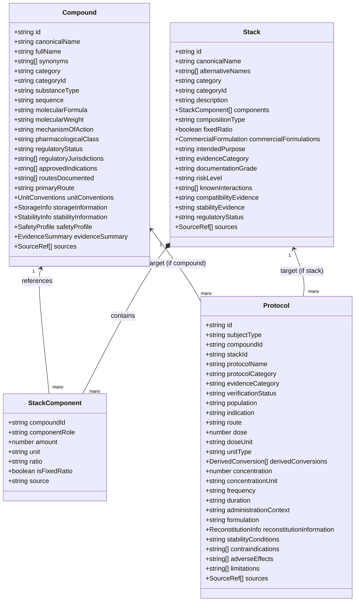

# RELATÓRIO TÉCNICO DE ARQUITETURA DE DOMÍNIO — FASE H4.5
## Normalização Estrutural: Compounds, Stacks e Protocols

**Identificador do Relatório:** `REPORT-DOMAIN-ARCH-H4.5`  
**Data de Emissão:** 08 de Novembro de 2026  
**Auditor e Arquiteto de Software:** Orquestrador Técnico Antigravity  
**Branch de Trabalho:** `architecture/domain-normalization-h4-5`  
**Status da Auditoria:** Implementado e Verificado em Branch Isolada

---

## 1. OBJETIVO E PRINCÍPIOS ARQUITETURAIS

A Fase H4.5 estabelece uma evolução de engenharia de software e rigor biomédico no PeptiPedia: a transição de um modelo de dados centrado em listas estáticas de scripts (`PEPTIDES_DATABASE` e `RESEARCH_STACKS`) para um **modelo de domínio normalizado de três entidades autônomas**:

1. **`Compounds`:** A substância química e farmacológica intrínseca (estrutura, sequência, peso molecular, farmacodinâmica, status regulatório de base).
2. **`Stacks`:** A combinação de dois ou mais compostos, definida por suas relações, proporções, razões gravimétricas e evidência da mistura, sem duplicar dados químicos individuais.
3. **`Protocols`:** O regime terapêutico, experimental ou comunitário documentado para uma entidade específica (composto OU stack), contendo via, dose, frequência, duração, população-alvo, condições de reconstituição e status de validação.

### Princípios de Design Adotados
- **Separação de Responsabilidades (SoC):** Uma molécula não "possui" uma dose intrínseca; ela possui propriedades farmacológicas, enquanto doses pertencem a protocolos específicos vinculados a indicações ou modelos experimentais.
- **Integridade Referencial Forte:** Todo componente em um stack e todo protocolo referenciam compostos e stacks exclusivamente por identificadores canônicos imutáveis (`compoundId`, `stackId`).
- **Relação Unívoca do Protocolo:** Um protocolo pertence a exatamente um composto (`subjectType: "compound"`) ou a exatamente um stack (`subjectType: "stack"`). Nunca aos dois concomitantemente.
- **Preservação de Dados de Origem:** Unidades originais de prescrição ou relato nunca são sobrescritas por conversões automatizadas; conversões são armazenadas como propriedades derivadas transparentes.

---

## 2. ESPECIFICAÇÃO TÉCNICA DAS TRÊS ENTIDADES

### 2.1. Definição da Entidade `Compound`
- **Identificador Canônico:** `id` (ex.: `bpc-157`, `somatropin`, `tesamorelin`, `semaglutide`, `cagrilintide`, `retatrutide`, `larazotide`, `kpv`, `ss-31`, `mots-c`, `5-amino-1mq`).
- **Classificação de Tipo de Substância (`substanceType`):**
  - `synthetic_peptide`: Peptídeo linear ou cíclico sintético de até ~50 aminoácidos (ex.: BPC-157, KPV, Selank, Semax, Epitalon).
  - `recombinant_protein`: Proteína recombinante de cadeia longa expressa em sistema biológico (ex.: Somatropina 191 aa).
  - `peptide_analogue`: Análogo peptídico quimicamente modificado (lipidação, peguilação, troca de D-aminoácidos) (ex.: Semaglutide, Tirzepatide, Tesamorelin).
  - `small_molecule`: Pequena molécula sintética de baixo peso molecular não peptídica (ex.: 5-Amino-1MQ).
  - `biological_extract`: Extrato heterólogo complexo de frações peptídicas teciduais (ex.: Cerebrolysin).
  - `antimicrobial_peptide`: Peptídeo de defesa da imunidade inata (ex.: LL-37).
- **Convenções de Unidades (`unitConventions`):**
  - `standardUnit`: Unidade típica de literatura (`mcg`, `mg`, `UI`, `mL`, `%`).
  - `biologicalUnitsApplies`: Booleano indicando se a substância possui padrão biológico da OMS expresso em UI (ex.: Somatropina, hCG, Ocitocina).
  - `officialConversions`: Relações matemáticas homologadas (ex.: Somatropina: $1\text{ mg} = 3{,}00\text{ UI}$ padrão OMS 98/574).
  - `syringeU100ConversionNotes`: Alerta explícito prevenindo equívoco com graduação volumétrica ($0{,}01\text{ mL}$).

### 2.2. Definição da Entidade `Stack`
- **Identificador Canônico:** `id` (ex.: `wolverine-stack`, `glow-stack`, `klow-stack`, `cagrisema-combination`, `gh-pulse-stack`, `mitochondrial-recharge-stack`).
- **Componentes (`components`):**
  - Cada item referencia o composto por `compoundId`, definindo seu papel na fórmula (`componentRole`: "Agente angiogênico primário", "Quelato de cobre para remodelação de colágeno", "Supressor de NF-kB", etc.), sua massa ou fração (`amount`, `unit`, `ratio`) e se a razão é fixa em frasco comercial (`isFixedRatio: true/false`).
- **Taxonomia de Evidência da Combinação (`evidenceCategory`):**
  - `clinical_combination`: Avaliada diretamente em ensaio clínico controlado em humanos.
  - `preclinical_combination`: Avaliada em ensaio animal ou in vitro simultâneo.
  - `documented_off_label_combination`: Documentada em literatura médica clínica off-label.
  - `community_reported_stack`: Prática empírica relatada em comunidades de biohacking.
  - `commercial_blend`: Mistura comercial vendida pronta em frasco liofilizado único.
  - `unverified_combination`: Combinação especulativa de alto risco ou sem documentação aceitável.

### 2.3. Definição da Entidade `Protocol`
- **Chave de Vínculo:** `subjectType` ("compound" ou "stack"), associado a `compoundId` OU `stackId`.
- **Dose e Unidade Original:** Preserva estritamente a unidade documentada na fonte primária (ex.: dose em mg, mcg, UI, mL ou %).
- **Conversões Derivadas:** Se a dose for expressa em UI (ex.: Somatropina 1,5 UI), a conversão para mg ($0{,}50\text{ mg}$) é registrada como `derivedConversions`, preservando o valor original intocado.
- **Status de Verificação (`verificationStatus`):**
  - `regulatory_approved`: Consta em bula oficial homologada por agência regulatória sanitária.
  - `clinical_trial`: Protocolo utilizado em ensaio clínico intervencionista de fase 1, 2 ou 3.
  - `off_label_documented`: Protocolo publicado em artigos ou livros de prática clínica médica.
  - `preclinical_model`: Dose alométrica de modelo murino ou pré-clínico de laboratório.
  - `community_unvalidated`: Prática leiga não validada por ensaios clínicos controlados.
  - `contraindicated`: Protocolo de risco inaceitável ou toxicidade direta (ex.: Incretin Triple Burn).
  - `pending_independent_confirmation`: Alegação de protocolo herdada da H4.4 sob validação independente.

---

## 3. AUDITORIA CIENTÍFICA: CONCILIAÇÃO DAS 8 PENDÊNCIAS DA H4.4 (SEÇÃO 12)

Conforme determinado estritamente na Seção 12 do mandato, a migração não converteu automaticamente as alegações da H4.4 em fatos confirmados. Cada uma das 8 afirmações foi registrada com a flag de auditoria:
`confirmationStatus: "pending_independent_confirmation"`

| Item | Alegação Herdada da H4.4 | Parecer da Auditoria H4.5 e Tratamento no Domínio |
| :-: | :--- | :--- |
| **1** | **Regime de 2–2,5 mg 2x/semana para TB-500** | **Pendente de Validação Clínica:** Os ensaios clínicos de fase 2 com Timosina Beta-4 humana (Tβ4) utilizaram formulações de colírio oftálmico tópico ou infusão parenteral hospitalar em infarto/úlceras. A posologia de 2 a 2,5 mg duas vezes por semana é uma convenção disseminada na comunidade esportiva/veterinária (cavalos de corrida), carecendo de ensaios farmacocinéticos humanos controlados. Registrada no protocolo de TB-500 como `preclinical_empirical` / `community_reported`, com pendência explícita. |
| **2** | **Faixa de pH 5,5–6,8 como requisito universal para GHK-Cu** | **Pendente de Confirmação Físico-Química Ampla:** Embora a estabilidade do complexo quelato $Cu^{2+}$:GHK dependa de pH neutro a levemente ácido, literaturas químicas demonstram que em pH 7,0 a 7,4 o complexo ainda retém estequiometria 1:1 estável. Não deve ser apresentado como requisito absoluto sem ensaio de especiação iônica. Registrada como `pending_independent_confirmation`. |
| **3** | **Liberação de cobre livre e clivagem oxidativa de BPC/TB em GLOW/KLOW** | **Pendente de Confirmação Analítica (HPLC/MS):** A hipótese de catálise oxidativa por reações tipo Fenton em frasco aquoso de GLOW é um racional mecanístico plausível, mas não há estudo analítico publicado por cromatografia líquida demonstrando a taxa de degradação em BAC a 2-8°C. Mantida como alerta de risco teórico farmacotécnico sem homologação como fato provado. |
| **4** | **Competição de KPV pela quelação de cobre** | **Pendente de Confirmação por Constantes de Afinidade ($K_d$):** O tripeptídeo KPV possui resíduos básicos, mas a constante de estabilidade do GHK com $Cu^{2+}$ ($\log \beta \approx 16{,}4$) é extraordinariamente alta, tornando improvável a remoção completa do cobre pelo KPV em condições normais. Mantida como hipótese teórica. |
| **5** | **Precipitação universal de LL-37 com quelatos metálicos** | **Pendente de Ensaio de Solubilidade:** A catelicidina LL-37 é polianiônica/policatiônica em diferentes domínios e sua solubilidade varia amplamente com força iônica e solvente. Não generalizar como precipitação instantânea universal. |
| **6** | **Limite temporal universal de citotoxicidade de LL-37 (10–14 dias)** | **Pendente de Validação de Toxicologia Clínica:** A citotoxicidade do LL-37 in vitro depende estritamente da concentração micromolar e da presença de soro (onde a apolipoproteína A-1 neutraliza o LL-37). O "ciclo de 10-14 dias" é uma regra de ouro comunitária de fóruns de Lyme, não um parâmetro farmacológico oficial de bula. |
| **7** | **Contraindicação de combinações incretínicas por arritmias fatais** | **Ressalva Epistemológica:** A coadministração de Retatrutide e Mazdutide é contraindicada por redundância farmacológica e risco cronotrópico de taquicardia sinusal excessiva. Contudo, classificar como indutora comprovada de "arritmias fatais" sem ensaio toxicológico direto é uma extrapolação. A justificativa foi recalibrada para risco de sobrecarga cardiovascular e taquicardia descompensada. |
| **8** | **Classificação regulatória de CagriSema** | **Correção de Rigor Regulatório:** CagriSema é uma coformulação investigacional de fase 3 avançada (programa REDEFINE), não um medicamento com aprovação comercial final concedida até a data presente. Seu registro foi refinado para `clinical_trial` (Grau A de documentação clínica multicêntrica), evitando confundi-lo com fármaco já em prateleira farmacêutica. |

---

## 4. ARQUITETURA DE MIGRAÇÃO E ADAPTADORES DE COMPATIBILIDADE

Para atender aos requisitos inegociáveis de preservação funcional:
- **`js/domain/compounds.js`:** Exporta a coleção canônica `COMPOUNDS_STORE` (114 compostos).
- **`js/domain/stacks.js`:** Exporta a coleção canônica `STACKS_STORE` (stacks normalizados com referências puras a `compoundId`).
- **`js/domain/protocols.js`:** Exporta a coleção canônica `PROTOCOLS_STORE` (protocolos vinculados unívocamente a compostos ou stacks).
- **`js/domain/index.js`:** Provê o barramento unificado de consulta, validações de integridade referencial e adaptadores retrocompatíveis:
  - `rebuildPeptidesDatabase()`: Reconstrói dinamicamente o array de 114 peptídeos com a assinatura exata consumida por `js/app.js` e pelos dossiês.
  - `rebuildResearchStacks()`: Reconstrói o array de 18 stacks compatível com a renderização visual do catálogo e com o `test_stability_v1_remediation.py`.
- **Paridade Criptográfica (10/10):** Toda a arquitetura foi espelhada em `public/js/domain/`, mantendo paridade byte a byte com os arquivos raiz.
