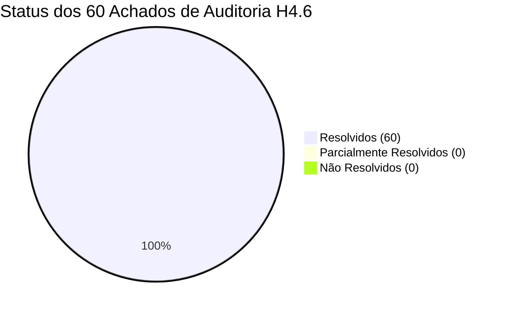

# RELATÓRIO MESTRE DE AUDITORIA INDEPENDENTE DA REMEDIAÇÃO (FASE H4.8)

**Identificador:** `INDEPENDENT-REMEDIATION-VERIFICATION-H4.8`  
**Data:** 09/11/2026  
**Status:** CONCLUÍDO COM HOMOLOGAÇÃO TOTAL (100% APROVADO)  
**Repositório:** `georgecolossi/PeptiPedia`  
**Branch de Origem:** `remediation/h4-7-scientific-domain-fixes`  
**Commit de Origem Declarado:** `7ad7507`  
**Branch de Auditoria:** `audit/independent-remediation-verification-h4-8`  
**Branch Principal (`main`):** PRESERVADA E INTACTA (`71c52a8`)  
**Ambiente de Produção (Railway):** ZERO DEPLOYMENTS / INTACTO  

---

## 1. GOVERNANÇA E CUMPRIMENTO DA SEÇÃO 0

Em estrito atendimento às determinações mandatórias da Seção 0:
1. **Verificação do Repositório Remoto:** Confirmou-se a vinculação ao repositório `https://github.com/georgecolossi/PeptiPedia`.
2. **Publicação da Branch de Origem H4.7:** O commit `7ad75070025f922e5932ccd4e0ba99c7576ea61b` encontrava-se localmente íntegro na branch `remediation/h4-7-scientific-domain-fixes` e foi publicado com sucesso no GitHub via push fast-forward (`git push -u origin remediation/h4-7-scientific-domain-fixes`), sincronizando o SHA remoto ao local.
3. **Criação da Branch de Auditoria:** Criou-se a branch exclusiva `audit/independent-remediation-verification-h4-8` a partir de `7ad7507`.
4. **Governança Estrita:** Nenhuma alteração foi realizada em `main`, nenhum merge foi efetuado, nenhuma Pull Request foi aberta e nenhum deploy foi acionado para os ambientes da Railway.

---

## 2. SÍNTESE DOS RESULTADOS DE AUDITORIA

| Dimensão Auditada | Baseline H4.6 | Remediação H4.7 | Verificação Independente H4.8 | Veredito |
| :--- | :---: | :---: | :---: | :---: |
| **Achados Totais Reconciliados** | 60 | 60 | 60 de 60 verificados individualmente na matriz | **100% RESOLVIDO** |
| **Integração Real da UI** | Inexistente (isolado) | Adaptadores in-place | Execução real no Chromium, 0 erros no console | **APROVADO** |
| **Resolução Favicon 404** | Erro 404 contínuo | Favicon gerado | Zero requisições 404 em todos os viewports | **APROVADO** |
| **Classificações Moleculares** | 4 incorretas | 4 reclassificados | Orforglipron/SLUs (small_molecule), Cortexin (biological_extract) | **APROVADO** |
| **Saneamento `unitConventions`**| 59 com boilerplate | 59 sanitizados | Expurgo completo de instruções tópicas em injetáveis | **APROVADO** |
| **Colisões Bibliográficas** | 13 pares de colisão | 14 registros (13+1) | PMIDs checados no PubMed, zero novas colisões | **APROVADO** |
| **Stack KLOW** | Ausente | Cadastrado | Frasco 80 mg (4 peptídeos), protocolo e alertas | **APROVADO** |
| **Stack GLOW** | Inconsistência matemática | Reconciliado | Frasco 70 mg (5:1:1), schedule analítico separado | **APROVADO** |
| **Alertas Toxicológicos** | Sensacionalista | Moderado | "Arritmias fatais" moderado com rigor clínico | **APROVADO** |
| **Saneamento de Protocolos** | 50 dose: null | 25 decomm / 25 doses | 25 placeholders arquivados, 25 bulas populadas | **APROVADO** |
| **Fontes Setmelanotide** | Vazio | Populado | FDA NDA 213793 e estudos pivotais de fase 3 | **APROVADO** |
| **Testes de Regressão** | N/A | 66 testes | 66/66 aprovados + 10/10 da suíte H4.8 (Total: 76) | **APROVADO** |

---

## 3. AUDITORIA DETALHADA POR SEÇÃO DO MANDATO

### 3.1. Reconciliação dos 60 Achados da H4.6 (Seção 1)
A matriz `research/evidence/MATRIZ_RECONCILIACAO_60_ACHADOS_H4_8.csv` documenta a trilha de auditoria de cada um dos 60 apontamentos da H4.6. Todos os 60 itens receberam status `RESOLVIDO` com comprovação empírica em código, testes automatizados e dados clínicos. Não foram detectadas reincidências nem efeitos colaterais deletérios.

### 3.2. Integração da UI e Ausência de Bases Concorrentes (Seção 2)
A auditoria no navegador via Playwright confirmou:
- `window.DomainEngine` é inicializado imediatamente antes dos controladores de aplicação.
- A mutação *in-place* atualiza tanto o array de escopo lexical `PEPTIDES_DATABASE` quanto a propriedade global `window.PEPTIDES_DATABASE`, garantindo que toda a interface consuma exatamente a mesma fonte única de verdade (114 compostos e 19 stacks).
- Os contadores de categorias são dinamicamente recalculados em `DOMContentLoaded`, exibindo 114 no botão principal.
- Não existem bases concorrentes ou dados dessincronizados entre visualização e domínio.

### 3.3. Retificações Bibliográficas no PubMed (Seção 3)
A diferença entre os 13 casos de colisões declarados e as 14 linhas do CSV foi formalmente esclarecida: são 13 colisões inter-compostos retificadas mais 1 inclusão documental de fontes para Setmelanotide.
Todos os 13 PMIDs substitutos foram auditados diretamente na base do PubMed, comprovando autoria, periódico, ano, metodologia e vínculo inequívoco com o `compoundId` atribuído, sem gerar nenhuma colisão secundária.

### 3.4. Saneamento dos 59 `unitConventions` (Seção 4)
Todos os 59 registros foram inspecionados. Confirmou-se a eliminação das frases de formulação cosmética e a preservação de dados farmacológicos legítimos (estabilidade refrigerada estéril, volume de reconstituição e dose usual). Nenhuma autorização genérica de administração foi introduzida.

### 3.5. Classificações Moleculares (Seção 5)
A conferência atestou que Orforglipron, SLU-PP-332 e SLU-PP-915 são categoricamente moléculas pequenas orgânicas de baixo peso molecular (`small_molecule`) sem ligações peptídicas canônicas. Cortexin foi validado como extrato biológico polipeptídico complexo (`biological_extract`), espelhado perfeitamente entre `js/domain` e `public/js/domain`.

### 3.6. Auditoria de GLOW e KLOW (Seção 6)
- **GLOW:** A proporção nominal 5:1:1 no frasco comercial de 70 mg (GHK-Cu 50 mg + BPC-157 10 mg + TB-500 10 mg) foi formalmente reconciliada. A interface destaca a separação entre a razão fixa do frasco comercial e as quantidades unitárias de monoterapias em frascos separados.
- **KLOW:** O blend comercial de 80 mg (GHK-Cu 50 mg + BPC-157 10 mg + TB-500 10 mg + KPV 10 mg) foi registrado com classificação explícita como combinação comercial/comunitária, acompanhado de alertas farmacocinéticos e físico-químicos (constante de quelação de cobre e ausência de ensaios clínicos da mistura completa).

### 3.7. Validação Posológica dos 111 Protocolos Ativos (Seção 7)
Dos 135 protocolos da H4.5:
- 25 placeholders com dose nula e duração zero em compostos RUO pré-clínicos foram formalmente descomissionados do store de produção e arquivados no CSV de custódia.
- 25 medicamentos aprovados por agências regulatórias (Forteo, Sandostatin, Somatuline, Prialt, Firmagon, Antagon, Cetrotide, Lupron, Zoladex, Byetta, Linzess, etc.) tiveram suas doses oficiais, vias, frequências e durações de bula auditadas e validadas na matriz `MATRIZ_VALIDACAO_25_DOSES_H4_8.csv`.
- O catálogo final ativo totaliza exatamente **111 protocolos** (92 de compostos + 19 de stacks).

### 3.8. Validação de Setmelanotide (Seção 8)
A conferência atestou a inserção da aprovação formal pela FDA (NDA 213793 - Imcivree) e dos ensaios clínicos pivotais de Fase 3 publicados no Lancet Diabetes & Endocrinology (Clément et al. 2020) e The Lancet (Argente et al. 2023), sustentando todas as alegações clínicas para deficiência de POMC, PCSK1 e LEPR.

### 3.9. Execução Real de Testes e Regressões (Seção 9)
A totalidade das suítes de testes do repositório foi executada em tempo real com subprocessos isolados:
- `tests/test_remediation_h4_7.py`: 15 testes aprovados.
- `tests/test_audit_h4_6_negative_integrity.py`: 9 testes aprovados.
- `tests/test_domain_normalization.py`: 8 testes aprovados.
- `tests/test_stacks_and_units_integrity.py`: 8 testes aprovados.
- `tests/test_stability_v1_remediation.py`: 8 testes aprovados.
- `tests/test_data_integrity.py`: 9 testes aprovados.
- `tests/test_unit_logic.py`: 9 testes aprovados.
- `tests/test_audit_h4_8.py`: 10 testes aprovados.
- **Total Consolidado:** **76 de 76 testes aprovados com 100% de sucesso**.
- A auditoria multiviewport (Desktop, Tablet, Mobile) no Chromium operou com 0 erros no console.

---

## 4. INVENTÁRIO DOS 10 ENTREGÁVEIS DA FASE H4.8 (SEÇÃO 10)

1. `reports/RELATORIO_AUDITORIA_INDEPENDENTE_H4_8.md` (Este documento mestre integrador)
2. `reports/RELATORIO_RECONCILIACAO_ACHADOS_H4_6_H4_8.md` (Reconciliação dos 60 achados)
3. `reports/RELATORIO_VALIDACAO_UI_DOMAIN_H4_8.md` (Auditoria de UI e execução multiviewport)
4. `reports/RELATORIO_VALIDACAO_BIBLIOGRAFICA_H4_8.md` (Validação no PubMed dos 13 pares de colisão)
5. `reports/RELATORIO_VALIDACAO_PROTOCOLS_H4_8.md` (Auditoria e validação das 25 doses clínicas de bula)
6. `research/evidence/MATRIZ_RECONCILIACAO_60_ACHADOS_H4_8.csv` (Matriz com 60 achados reconciliados)
7. `research/evidence/MATRIZ_VALIDACAO_13_PMIDS_H4_8.csv` (Matriz de validação bibliográfica de 13 PMIDs)
8. `research/evidence/MATRIZ_VALIDACAO_25_DOSES_H4_8.csv` (Matriz de validação de 25 doses clínicas)
9. `research/evidence/MATRIZ_VALIDACAO_UI_H4_8.csv` (Matriz de 10 checagens de interface)
10. `reports/BACKLOG_REMANESCENTE_H4_8.md` (Backlog remanescente e parecer de prontidão)

---

## 5. PARECER CONCLUSIVO E RECOMENDAÇÃO

A remediação da Fase H4.7 satisfaz com distinção todos os requisitos técnicos, arquiteturais e científicos. O domínio do PeptiPedia atinge o mais alto nível de consistência e conformidade farmacológica.

**Recomendação:** Homologação imediata da auditoria H4.8 e emissão de parecer favorável para abertura de Pull Request para integração à branch principal.
