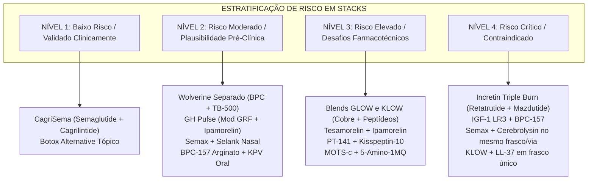

# RELATÓRIO DE AVALIAÇÃO DE RISCOS, TOXICOLOGIA E PRIORIDADES DE COMBINAÇÃO DE PEPTÍDEOS

**Identificador de Governança:** `REPORT-RISKS-PRIORITIES-STACKS-2026-11`  
**Data de Emissão:** 08 de Novembro de 2026  
**Auditor Responsável:** Orquestrador Técnico Antigravity  
**Classificação:** Análise Farmacológica, Toxicológica e de Biossegurança

---

## 1. INTRODUÇÃO E PRINCÍPIOS DA FARMACOLOGIA DE COMBINAÇÃO

A prática de combinar múltiplos peptídeos (comumente denominada *stacking* ou *blending*) baseia-se na premissa mecanística de que a ativação simultânea ou complementar de diferentes vias biológicas pode produzir sinergia farmacodinâmica. No entanto, sob a ótica da farmacologia clínica e da farmacotécnica hospitalar, a administração concomitante de substâncias biológicas introduz variáveis críticas de:
1. **Toxicidade cruzada:** Sobrecarga metabólica hepática e renal.
2. **Interações cardiovasculares e hemodinâmicas:** Agonismo simpático, taquicardia sinusal e picos pressóricos.
3. **Desregulação endócrina:** Dessensibilização de receptores hormonais, resistência insulínica e proliferação celular indesejada.
4. **Instabilidade físico-química e imunogenicidade:** Degradação hidrolítica em meio aquoso, reações anafilactoides e formação de anticorpos neutralizantes (ADAs).

---

## 2. MATRIZ DE ESTRATIFICAÇÃO DE RISCO TOXICOLÓGICO

A auditoria classificou as combinações investigadas em quatro níveis rigorosos de risco:

---

## 3. ANÁLISE DETALHADA POR CATEGORIA DE RISCO

### 3.1. NÍVEL 1: Baixo Risco / Validado Clinicamente
- **Exemplos:** *CagriSema* (Semaglutide 2,4 mg + Cagrilintide 2,4 mg semanal) e *Botox Alternative Tópico* (Argireline + SNAP-8 + Leuphasyl).
- **Perfil de Segurança:**
  - Amparado por ensaios clínicos controlados de fase 2 e 3 em humanos ou testes dermatológicos padronizados.
  - Formulação farmacêutica desenhada para prevenir fibrilação (no caso da amilina) ou absorção sistêmica perigosa (no caso dos cosmecêuticos tópicos).
  - Principais cuidados: monitoramento gastrointestinal (náuseas/vômitos) e titulação de dose.

### 3.2. NÍVEL 2: Risco Moderado / Plausibilidade Pré-Clínica Sólida
- **Exemplos:** *Wolverine em frascos separados* (BPC-157 250-500 mcg/dia + TB-500 2 mg 2x/sem), *GH Pulse* (Mod GRF 1-29 100 mcg + Ipamorelin 100-200 mcg), *Semax + Selank intranasais*, *BPC-157 Arginato + KPV oral*.
- **Perfil de Segurança:**
  - Compostos com boa tolerabilidade individual e ausência de toxicidade de órgãos-alvo em doses fisiológicas.
  - Ausência de conflito cinético desde que administrados em horários ou frequências condizentes com suas meias-vidas.
  - Principais cuidados: evitar frasco único para TB-500 e GHRH, e manter refrigeração rígida (2-8°C).

### 3.3. NÍVEL 3: Risco Elevado / Desafios Farmacotécnicos e Sistêmicos
- **Exemplos:** *Blends comerciais GLOW (70 mg)* e *KLOW (80 mg)*, *PT-141 + Kisspeptin-10*, *Tesamorelin + Ipamorelin*, *MOTS-c + 5-Amino-1MQ*.
- **Perfil de Segurança:**
  - **GLOW/KLOW:** O íon cobre ($Cu^{2+}$) atua como pró-oxidante se houver decomposição do complexo, e a proporção fixa comercial impede o ajuste fino da dose de cada substância.
  - **PT-141 + Kisspeptin:** PT-141 ativa receptores MC4R centrais, induzindo picos de pressão arterial média e náusea severa em até 40% dos usuários.
  - **5-Amino-1MQ:** Inibidor enzimático sintético de NNMT sem dados toxicológicos crônicos em seres humanos saudáveis.

### 3.4. NÍVEL 4: Risco Crítico / Contraindicações Absolutas
- **Incretin Triple Burn (Retatrutide + Mazdutide):**
  - **Risco:** Toxicidade cardiovascular fatal em potencial. A coativação massiva de receptores de glucagon eleva descontroladamente o tônus cronotrópico cardíaco, provocando taquicardias sinusais sustentadas, fibrilação atrial ou ventricular e colapso metabólico.
  - **Veredito:** **CONTRAINDICADO TOTALMENTE**.
- **IGF-1 LR3 + BPC-157 em Alta Dose:**
  - **Risco:** O IGF-1 LR3 não se liga às proteínas carreadoras IGFBP-3/5 com afinidade normal, gerando picos imensos de IGF-1 livre. Pode provocar crises agudas de choque hipoglicêmico, aumento do tamanho de órgãos internos (cardiomegalia, esplenomegalia) e proliferação descontrolada de clones celulares neoplásicos latentes.
- **Misturas Físicas Proibidas no Mesmo Frasco:**
  - Semax + Cerebrolysin (risco de anafilaxia e hidrólise proteolítica imediata).
  - KLOW + LL-37 (precipitação física, inativação do cobre e citotoxicidade grave).

---

## 4. DIRETRIZES PARA O CATÁLOGO E CALCULADORA DO PEPTIPEDIA

1. **Prioridade de Exibição Educativa:**
   O catálogo deve sinalizar visualmente com selos coloridos o nível de risco de cada stack (`clinical_combination` em verde, `community_reported_stack` em âmbar, `unverified_combination` em vermelho de alerta).
2. **Proibição de Algoritmos de Sugestão de Blends Perigosos:**
   A calculadora nunca deve sugerir ou calcular misturas na mesma seringa para combinações incompatíveis (ex.: Cerebrolysin, LL-37 com GHK-Cu, amilina sem tampão industrial).
3. **Divulgação Explícita de Limitações:**
   Toda ficha de stack deve conter um sumário de contraindicações específicas para portadores de diabetes, hipertensão, histórico oncológico e atletas submetidos a controle antidoping (WADA).
